# 📱 Документация для Frontend и Mobile разработчиков: Сценарии и API Контракты (YolYolakay)

Данный документ предназначен для разработчиков мобильных приложений (iOS / Android / Flutter / React Native) и веб-клиентов платформы **YolYolakay**. 

Каждый сценарий описывает:
1. **Пользовательский сценарий (UI/UX логика):** поведение экранов, поля ввода, валидация на клиенте и переходы.
2. **API-контракты:** точный адрес эндпоинта, обязательные заголовки, тело запроса, успешные ответы и обработка ошибок.

---

## 🌐 0. Общие технические требования к клиентам

* **Базовый URL бэкенда (API Gateway):**
  `https://api.yolyolakay.com`

* **Обязательные HTTP-заголовки для ВСЕХ запросов:**
  | Заголовок | Тип | Пример значения | Описание |
  | :--- | :--- | :--- | :--- |
  | `Content-Type` | String | `application/json` | Формат данных тела запроса. |
  | `X-Device-ID` | UUID / String | `e5b7a192-3c4a-4f81-9b1c-32f22b8287d1` | Постоянный уникальный идентификатор устройства. Генерируется при первом запуске приложения и надежно сохраняется в **Keychain (iOS)** или **EncryptedSharedPreferences / KeyStore (Android)**. Не должен меняться при перезапусках приложения! |
  | `X-OS-Type` | String | `android` / `ios` / `web` | Операционная система устройства в нижнем регистре. |
  | `User-Agent` | String | `YolYolakay-App/2.0 (Android 14; Samsung S24)` | Имя и версия клиентского приложения и модели телефона. |
  | `Authorization` | String | `Bearer eyJhbGciOiJSUzI1NiIs...` | JWT Access-токен (передается во всех авторизованных запросах). |

---

## 🚀 СЦЕНАРИЙ 1: РЕГИСТРАЦИЯ НОВОГО КЛИЕНТА

Регистрация клиента проходит в **3 логических этапа**:
1. Ввод номера телефона и пароля $\rightarrow$ отправка SMS с проверочным кодом;
2. Ввод 5-значного проверочного кода из SMS $\rightarrow$ подтверждение, регистрация аккаунта, сохранение пароля и получение JWT токенов;
3. Первичный онбординг $\rightarrow$ заполнение анкеты (имя, фамилия, пол, язык).

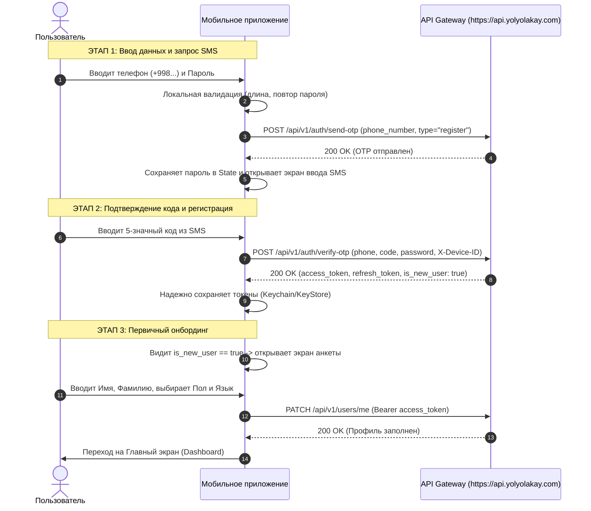

---

### ЭТАП 1. Экран ввода телефона и пароля (UI & Запрос кода)

#### 1.1. Логика пользовательского интерфейса (UI/UX)
1. Клиент открывает экран регистрации.
2. Пользователь видит следующие поля:
   * **Номер телефона:** маска ввода Узбекистана `+998 (XX) XXX-XX-XX`.
   * **Пароль:** маскированное поле ввода (с иконкой «глаз» для показа/скрытия). Валидация: **минимум 6 символов**.
   * **Подтверждение пароля:** сверка с первым полем (пароли должны строго совпадать).
   * **Чекбокс согласия:** «Я принимаю условия Пользовательского соглашения и Политики конфиденциальности».
3. При нажатии на кнопку **«Получить проверочный код»** приложение:
   * Проверяет заполненность всех полей и совпадение паролей;
   * Сохраняет введенный пользователем пароль в локальной памяти формы (в `state` / `ViewModel` / `Bloc`), чтобы передать его на следующем шаге после подтверждения SMS;
   * Отправляет запрос на бэкенд для отправки SMS-кода.

#### 1.2. API Контракт: Отправка SMS OTP
* **Метод:** `POST`
* **Адрес (URL):** `https://api.yolyolakay.com/api/v1/auth/send-otp`
* **Авторизация:** Не требуется (публичный эндпоинт)
* **Заголовки запроса:**
  ```http
  Content-Type: application/json
  X-Device-ID: e5b7a192-3c4a-4f81-9b1c-32f22b8287d1
  X-OS-Type: android
  User-Agent: YolYolakay-App/2.0 (Android 14; Samsung S24)
  ```
* **Тело запроса (JSON):**
  ```json
  {
    "phone_number": "+998901234567",
    "type": "register"
  }
  ```
  > ⚠️ **Важно:** Поле `type` для сценария регистрации должно иметь строго значение `"register"`.

* **Успешный ответ бэкенда (`200 OK`):**
  ```json
  {
    "message": "OTP sent successfully"
  }
  ```
  *Действие приложения:* переключить экран на ввод 5-значного кода SMS. Запустить таймер обратного отсчета на 60 секунд.

* **Обработка возможных ошибок:**
  | HTTP Код | Тело ошибки | Причина и реакция UI |
  | :--- | :--- | :--- |
  | `409 Conflict` | `{"error": "user already exists"}` | **Номер уже зарегистрирован.** Показать диалог: *«Пользователь с таким номером уже существует. Хотите войти?»* и кнопку перехода на экран «Вход по паролю / SMS». |
  | `400 Bad Request` | `{"error": "invalid request body or missing 'type'"}` | Неверный формат номера телефона. Показать подсказку под полем ввода. |
  | `429 Too Many Requests` | `{"error": "rate limit exceeded: max 3 requests per 5 minutes"}` | Пользователь запросил SMS более 3 раз за 5 минут. Показать alert: *«Слишком много запросов. Попробуйте через 5 минут»*. |
  | `429 Too Many Requests` | `{"error": "rate limit exceeded: max 10 requests per hour from this IP"}` | Превышен лимит запросов с IP-адреса. |

> ℹ️ **Служебный тестовый номер для модераторов Apple и Google:**
> * Телефон: `+998991234567` (или любой номер, начинающийся с `+99800`)
> * Статический проверочный код OTP: `99887` (SMS физически не отправляется, принимается сервером всегда).

---

### ЭТАП 2. Экран подтверждения SMS и создание аккаунта

#### 2.1. Логика пользовательского интерфейса (UI/UX)
1. Пользователь видит:
   * Заголовок: *«Введите 5-значный код из SMS»*.
   * Подсказку: *«Код отправлен на номер +998 (90) 123-45-67»*.
   * 5 раздельных ячеек (Pin Code Input) для цифр.
   * Таймер: *«Отправить код повторно через 00:59»*. При истечении таймера появляется активная ссылка *«Отправить код повторно»* (повторный вызов `POST /api/v1/auth/send-otp`).
2. Как только пользователь заполнил 5 цифр:
   * Приложение автоматически блокирует поле ввода (индикатор загрузки);
   * Отправляет запрос верификации, передавая код из SMS **вместе с паролем**, который был сохранен на Шаге 1.

#### 2.2. API Контракт: Верификация OTP и создание аккаунта
* **Метод:** `POST`
* **Адрес (URL):** `https://api.yolyolakay.com/api/v1/auth/verify-otp`
* **Авторизация:** Не требуется
* **Заголовки запроса:**
  ```http
  Content-Type: application/json
  X-Device-ID: e5b7a192-3c4a-4f81-9b1c-32f22b8287d1
  X-OS-Type: android
  User-Agent: YolYolakay-App/2.0 (Android 14; Samsung S24)
  ```
* **Тело запроса (JSON):**
  ```json
  {
    "phone_number": "+998901234567",
    "code": "48291",
    "password": "SecurePassword123!"
  }
  ```
  *(Поле `password` является обязательным при регистрации. Бэкенд автоматически создает пользователя, хэширует пароль и связывает его с учетной записью).*

* **Успешный ответ бэкенда (`200 OK`):**
  ```json
  {
    "access_token": "eyJhbGciOiJSUzI1NiIsInR5cCI6IkpXVCJ...",
    "refresh_token": "a1b2c3d4-e5f6-7890-abcd-ef1234567890",
    "is_new_user": true
  }
  ```
* **Действия клиентского приложения при успехе:**
  1. Надежно сохранить `access_token` и `refresh_token` в KeyStore / Keychain;
  2. Проверить флаг `is_new_user`:
     * Если `is_new_user == true` $\rightarrow$ **перейти к Этапу 3 (Заполнение профиля)**;
     * Если `is_new_user == false` $\rightarrow$ пользователь уже был зарегистрирован ранее $\rightarrow$ сразу открыть Главный экран.

* **Обработка возможных ошибок:**
  | HTTP Код | Тело ошибки | Причина и реакция UI |
  | :--- | :--- | :--- |
  | `401 Unauthorized` | `{"error": "invalid or expired OTP"}` | **Неверный или просроченный код.** Очистить ячейки ввода кода, подсветить их красным и показать сообщение: *«Неверный код подтверждения»*. |
  | `423 Locked` | `{"error": "account is temporarily locked due to too many failed attempts"}` | **5 неверных попыток ввода.** Аккаунт временно заблокирован на 15 минут для защиты от перебора. Показать alert с таймером блокировки. |
  | `400 Bad Request` | `{"error": "password must be at least 6 characters long"}` | Переданный пароль короче 6 символов. |

---

### ЭТАП 3. Экран первичного онбординга (Заполнение анкеты)

Так как при регистрации бэкенд создает профиль с временным именем по умолчанию (`Новый Пользователь`), клиент обязан заполнить персональные данные.

#### 3.1. Логика пользовательского интерфейса (UI/UX)
1. Пользователь видит экран *«Расскажите о себе»*.
2. Поля ввода:
   * **Имя:** текстовое поле (обязательно, от 2 до 50 символов);
   * **Фамилия:** текстовое поле (обязательно, от 2 до 50 символов);
   * **Пол:** переключатель (радиокнопка): *Мужской (`male`)* / *Женский (`female`)*.
     > ⚠️ **Важно:** Выбор пола критически важен, так как в системе действует алгоритм «Women Only» (женские поездки, доступные только водителям и пассажирам женского пола).
   * **Язык приложения:** переключатель: *O'zbekcha (`uz`)* / *Русский (`ru`)*.
   * **Аватар профиля (опционально):** фото с камеры или галереи.
3. Кнопка: **«Завершить регистрацию»**.

#### 3.2. API Контракт: Сохранение данных профиля
* **Метод:** `PATCH` *(также поддерживается `PUT /api/v1/users/profile`)*
* **Адрес (URL):** `https://api.yolyolakay.com/api/v1/users/me`
* **Авторизация:** Требуется Bearer-токен, полученный на Этапе 2!
* **Заголовки запроса:**
  ```http
  Content-Type: application/json
  Authorization: Bearer <access_token>
  X-Device-ID: e5b7a192-3c4a-4f81-9b1c-32f22b8287d1
  X-OS-Type: android
  User-Agent: YolYolakay-App/2.0 (Android 14; Samsung S24)
  ```
* **Тело запроса (JSON):**
  ```json
  {
    "first_name": "Алишер",
    "last_name": "Усманов",
    "gender": "male",
    "locale": "uz",
    "avatar_url": "https://s3.yolyolakay.uz/media/avatars/user_photo.jpg"
  }
  ```
  *(Поле `avatar_url` опционально. Если пользователь выбрал фото, оно предварительно загружается через медиа-сервис `POST /api/v1/media/upload`, возвращающий готовый URL).*

* **Успешный ответ бэкенда (`200 OK`):**
  ```json
  {
    "id": "e3b8a192-3c4a-4f81-9b1c-32f22b8287d1",
    "first_name": "Алишер",
    "last_name": "Усманов",
    "gender": "male",
    "phone_number": "+998901234567",
    "role": "passenger",
    "kyc_status": "none",
    "status": "active",
    "locale": "uz",
    "rating": 5.0,
    "rating_count": 0,
    "created_at": "2026-09-08T16:20:00Z",
    "updated_at": "2026-09-08T16:22:00Z"
  }
  ```
* **Действие клиентского приложения:**
  Регистрация и первичный онбординг успешно завершены! Закрыть экран регистрации и перевести пользователя на **Главный экран приложения**.

---

## 🔑 СЦЕНАРИЙ 2: ВХОД В СУЩЕСТВУЮЩИЙ АККАУНТ (ПРОВЕРКА УСТРОЙСТВА)

В платформе YolYolakay реализована умная 2FA-защита аккаунта по устройству (**Device Fingerprinting / Trusted Devices**):
* **Если устройство знакомое (уже авторизовывалось ранее):** вход осуществляется **мгновенно по номеру телефона и паролю** без SMS.
* **Если устройство новое (незнакомый `X-Device-ID`):** сервер проверяет пароль, автоматически генерирует и отправляет SMS с проверочным кодом. После ввода кода устройство привязывается к доверенным, и последующие входы происходят без SMS.

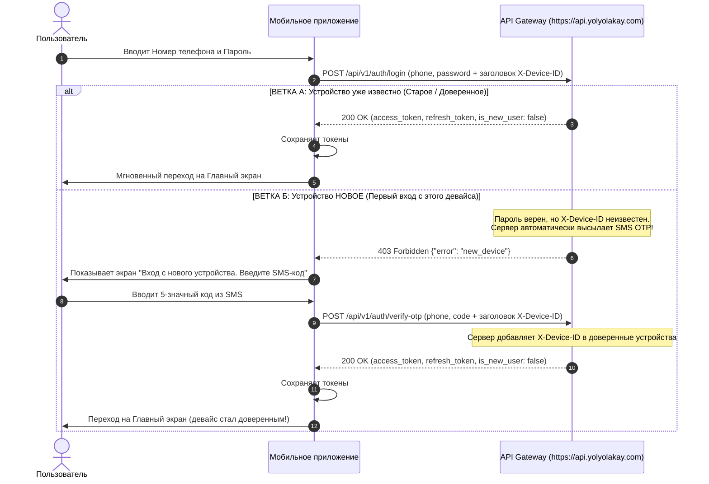

---

### 2.1. Шаг 1: Экран авторизации (Ввод номера и пароля)

#### Логика пользовательского интерфейса (UI/UX)
1. Пользователь нажимает «Войти» на стартовом экране.
2. Поля ввода:
   * **Номер телефона:** маска `+998 (XX) XXX-XX-XX`.
   * **Пароль:** маскированное поле ввода (с кнопкой показать/скрыть).
   * Ссылка: *«Забыли пароль?»* (сценарий сброса через SMS OTP).
   * Кнопка: **«Войти»**.
3. При нажатии «Войти» приложение отправляет запрос на сервер с обязательным заголовком `X-Device-ID`.

#### API Контракт: Вход по паролю
* **Метод:** `POST`
* **Адрес (URL):** `https://api.yolyolakay.com/api/v1/auth/login`
* **Авторизация:** Не требуется (публичный эндпоинт)
* **Заголовки запроса:**
  ```http
  Content-Type: application/json
  X-Device-ID: e5b7a192-3c4a-4f81-9b1c-32f22b8287d1
  X-OS-Type: android
  User-Agent: YolYolakay-App/2.0 (Android 14; Samsung S24)
  ```
* **Тело запроса (JSON):**
  ```json
  {
    "phone_number": "+998901234567",
    "password": "SecurePassword123!"
  }
  ```

---

### 2.2. Обработка ответа: Старое устройство против Нового устройства

#### ВАРИАНТ А: Устройство старое (доверенное) $\rightarrow$ Статус `200 OK`
Если переданный `X-Device-ID` уже есть в списке доверенных устройств этого аккаунта, сервер сразу авторизует пользователя:

* **Ответ бэкенда (`200 OK`):**
  ```json
  {
    "access_token": "eyJhbGciOiJSUzI1NiIsIn...",
    "refresh_token": "a1b2c3d4-e5f6-7890-abcd-ef1234567890",
    "is_new_user": false
  }
  ```
* **Реакция мобильного приложения:**
  * Сохранить токены в Keychain / KeyStore;
  * Сразу открыть Главный экран (Dashboard). **Никаких SMS запрашивать не нужно!**

---

#### ВАРИАНТ Б: Устройство новое (незнакомый `X-Device-ID`) $\rightarrow$ Статус `403 Forbidden`
Если пароль введен верно, но `X-Device-ID` отсутствует в списке доверенных устройств:
* Сервер **автоматически генерирует 5-значный OTP и отправляет SMS** на номер пользователя через шлюз Eskiz.uz.
* Возвращает ответ:
  ```json
  {
    "error": "new_device",
    "message": "Новое устройство. СМС-код успешно отправлен."
  }
  ```

* **Реакция мобильного приложения:**
  1. Приложение перехватывает код `403` с полем `"error": "new_device"`.
  2. Автоматически открывает экран ввода проверочного SMS-кода.
  3. Показывает баннер/подсказку:
     > 🔒 *«Мы обнаружили вход с нового устройства. В целях безопасности на ваш номер отправлен проверочный SMS-код»*.
  4. Запускает таймер обратного отсчета (60 секунд).

---

### 2.3. Шаг 2 (только для нового устройства): Подтверждение SMS и привязка устройства

Пользователь вводит 5-значный код из полученного SMS.

#### API Контракт: Подтверждение кода
* **Метод:** `POST`
* **Адрес (URL):** `https://api.yolyolakay.com/api/v1/auth/verify-otp`
* **Заголовки запроса:** Обязательно передать **тот же самый** `X-Device-ID`!
  ```http
  Content-Type: application/json
  X-Device-ID: e5b7a192-3c4a-4f81-9b1c-32f22b8287d1
  X-OS-Type: android
  User-Agent: YolYolakay-App/2.0 (Android 14; Samsung S24)
  ```
* **Тело запроса (JSON):**
  ```json
  {
    "phone_number": "+998901234567",
    "code": "48291"
  }
  ```

* **Что делает бэкенд:**
  1. Проверяет корректность OTP-кода в Redis;
  2. Находит пользователя в базе данных;
  3. **Автоматически добавляет `X-Device-ID` в список `trusted_devices` пользователя**;
  4. Создает сессию в Redis и возвращает пару JWT-токенов.

* **Успешный ответ бэкенда (`200 OK`):**
  ```json
  {
    "access_token": "eyJhbGciOiJSUzI1NiIsIn...",
    "refresh_token": "a1b2c3d4-e5f6-7890-abcd-ef1234567890",
    "is_new_user": false
  }
  ```

* **Реакция мобильного приложения:**
  1. Сохранить токены в KeyStore / Keychain;
  2. Открыть Главный экран (Dashboard);
  3. **Результат:** данное устройство теперь привязано к аккаунту. При следующих входах пользователь будет входить мгновенно только по телефону и паролю!

---

### 2.4. Обработка ошибок при входе (Таблица кодов)

| HTTP Код | Тело ответа | Причина и реакция приложения (UI) |
| :--- | :--- | :--- |
| `401 Unauthorized` | `{"error": "invalid phone or password"}` | **Неверный телефон или пароль.** Подсветить поля ввода красным и показать сообщение: *«Неверный номер телефона или пароль»*. |
| `401 Unauthorized` | `{"error": "password is not set for this account, please use OTP login"}` | Пользователь регистрировался без пароля и еще не задал его. Предложить: *«Для вашего аккаунта не установлен пароль. Войти по SMS?»* и переключить на сценарий SMS-входа (`POST /api/v1/auth/send-otp` с `type="login"`). |
| `423 Locked` | `{"error": "account is temporarily locked due to too many failed attempts"}` | **5 неверных попыток ввода пароля подряд.** Аккаунт временно заблокирован на 15 минут для предотвращения брутфорса. Заблокировать кнопку входа и показать обратный отсчет. |
| `429 Too Many Requests` | `{"error": "new_device_sms_failed", "message": "..."}` | Слишком частые попытки запроса SMS на новом устройстве (более 3 раз за 5 минут). Показать: *«Превышен лимит отправки SMS. Попробуйте через 5 минут»*. |

---

### 2.5. Важные правила работы с токенами и безопасность

1. **Автоматическое продление токенов (Interceptors):**
   * Токен `access_token` имеет ограниченное время жизни (1 час).
   * Настройте сетевой перехватчик (Axios Interceptor / Retrofit Authenticator / Dio Interceptor): при получении ошибки `401 Unauthorized` на любом защищенном запросе приложение должно прозрачно вызвать `POST /api/v1/auth/refresh` с сохраненным `refresh_token`, получить новую пару токенов и повторить упавший запрос.
2. **Безопасность:**
   * Не сохраняйте пароль в незашифрованном виде после завершения регистрации или смены.
   * `refresh_token` должен храниться только в защищенном хранилище ОС устройства (`Keychain` на iOS, `EncryptedSharedPreferences` / `KeyStore` на Android).

---

## 🔑 СЦЕНАРИЙ 3: ВОССТАНОВЛЕНИЕ И СБРОС ЗАБЫТОГО ПАРОЛЯ («ЗАБЫЛИ ПАРОЛЬ?»)

Когда пользователь забыл свой постоянный пароль, он восстанавливает доступ через подтверждение владения номером телефона по SMS.

Сценарий состоит из **3 последовательных шагов**:
1. Ввод номера телефона $\rightarrow$ проверка пользователя в БД и отправка специального SMS-кода сброса;
2. Ввод 5-значного SMS-кода $\rightarrow$ проверка кода и авторизация временной сессии;
3. Ввод нового пароля и его подтверждение $\rightarrow$ сохранение нового пароля в БД и переход на Главный экран.

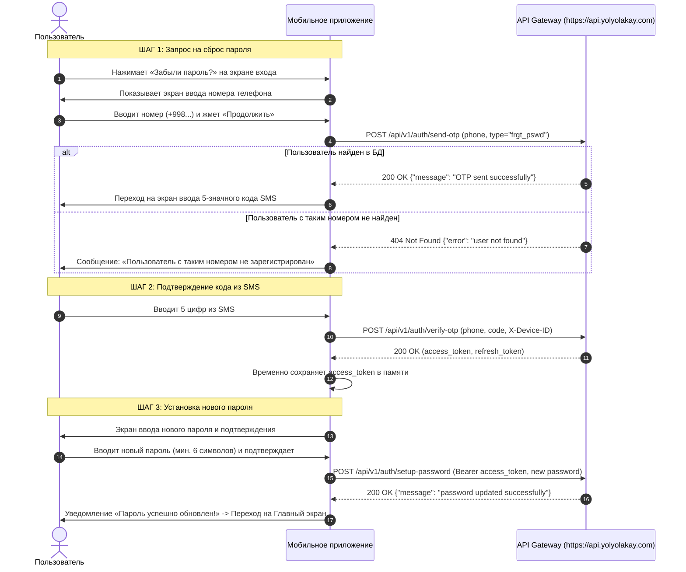

---

### 3.1. ШАГ 1: Запрос кода сброса пароля (UI/UX и API)

* **Экран приложения:** Экран «Восстановление пароля».
* **Поля ввода:**
  * Поле номера телефона с маской `+998 (XX) XXX-XX-XX`.
  * Кнопка «Получить код».
* **Валидация на клиенте:** Проверить, что введено ровно 9 цифр после кода страны `+998`.

#### 📡 API Запрос: Отправка SMS для сброса пароля
* **Метод:** `POST`
* **Адрес (URL):** `https://api.yolyolakay.com/api/v1/auth/send-otp`
* **Заголовки:**
  ```http
  Content-Type: application/json
  X-Device-ID: e5b7a192-3c4a-4f81-9b1c-32f22b8287d1
  X-OS-Type: android
  User-Agent: YolYolakay-App/2.0 (Android 14; Samsung S24)
  ```
* **Тело запроса (JSON):**
  ```json
  {
    "phone_number": "+998901234567",
    "type": "frgt_pswd"
  }
  ```
  > [!IMPORTANT]
  > Параметр `type` обязательно должен быть `"frgt_pswd"`. Бэкенд проверит, что пользователь с таким номером существует, и шлюз Eskiz отправит утвержденный сервисный шаблон:
  > *«Yolyolakay platformasining parolini tiklash uchun tasdiqlash kodi: 12345»*.

* **Успешный ответ бэкенда (`200 OK`):**
  ```json
  {
    "message": "OTP sent successfully"
  }
  ```
* **Реакция мобильного приложения:**
  * Запустить 60-секундный таймер обратного отсчета для повторной отправки SMS.
  * Переключить экран на ввод 5-значного проверочного кода.

* **Возможные ошибки:**
  | HTTP Код | Тело ответа | Значение и реакция интерфейса |
  | :--- | :--- | :--- |
  | `404 Not Found` | `{"error": "user not found"}` | Аккаунт с таким номером телефона не зарегистрирован. Предложить пользователю: *«Пользователь не найден. Зарегистрироваться?»* со ссылкой на Сценарий 1. |
  | `429 Too Many Requests` | `{"error": "rate limit exceeded: max 3 requests per 5 minutes"}` | Пользователь слишком часто запрашивает SMS (более 3 раз за 5 минут). Заблокировать кнопку на 5 минут и вывести таймер. |
  | `429 Too Many Requests` | `{"error": "rate limit exceeded: max 10 requests per hour from this IP"}` | Превышен лимит запросов с IP-адреса устройства. Вывести: *«Слишком много попыток. Повторите через 1 час»*. |

---

### 3.2. ШАГ 2: Подтверждение кода из SMS (UI/UX и API)

* **Экран приложения:** Экран «Введите код из SMS».
* **Компоненты:**
  * 5 отдельных ячеек (Pin Code Input) с автоматическим фокусом и автофокусом следующей ячейки;
  * Автоматическое считывание SMS на Android (SMS Retriever API / SMS User Consent API);
  * Кнопка «Отправить код повторно» (становится активной после истечения 60 секунд).

#### 📡 API Запрос: Проверка проверочного кода
* **Метод:** `POST`
* **Адрес (URL):** `https://api.yolyolakay.com/api/v1/auth/verify-otp`
* **Заголовки:**
  ```http
  Content-Type: application/json
  X-Device-ID: e5b7a192-3c4a-4f81-9b1c-32f22b8287d1
  X-OS-Type: android
  User-Agent: YolYolakay-App/2.0 (Android 14; Samsung S24)
  ```
* **Тело запроса (JSON):**
  ```json
  {
    "phone_number": "+998901234567",
    "code": "52814"
  }
  ```

* **Успешный ответ бэкенда (`200 OK`):**
  ```json
  {
    "access_token": "eyJhbGciOiJSUzI1NiIsInR5cCI6IkpXVCJ9...",
    "refresh_token": "f47ac10b-58cc-4372-a567-0e02b2c3d479",
    "is_new_user": false
  }
  ```

* **Реакция мобильного приложения:**
  * Сохранить полученный `access_token` и `refresh_token`;
  * Перевести пользователя на экран **«Установите новый пароль»**.

* **Возможные ошибки:**
  | HTTP Код | Тело ответа | Значение и реакция интерфейса |
  | :--- | :--- | :--- |
  | `401 Unauthorized` | `{"error": "invalid or expired verification code"}` | **Код неверен или истек (срок жизни кода 2 минуты).** Очистить поля ввода, подсветить красным и показать сообщение: *«Неверный код или срок его действия истек»*. |
  | `401 Unauthorized` | `{"error": "account is temporarily locked due to too many failed attempts"}` | **5 неверных попыток ввода кода подряд.** Номер заблокирован на 15 минут от брутфорса. Заблокировать ввод и показать обратный отсчет. |

---

### 3.3. ШАГ 3: Установка и сохранение нового пароля (UI/UX и API)

* **Экран приложения:** Экран «Новый пароль».
* **Поля ввода:**
  * «Новый пароль» (с кнопкой показать/скрыть глазок);
  * «Повторите новый пароль»;
  * Индикатор надежности пароля (зеленые чекбоксы: минимум 6 символов, наличие букв и цифр);
  * Кнопка «Сохранить и войти».
* **Валидация на клиенте:**
  * Длина нового пароля должна быть не менее 6 символов;
  * Поля «Новый пароль» и «Повторите новый пароль» должны посимвольно совпадать.

#### 📡 API Запрос: Сохранение нового пароля
* **Метод:** `POST`
* **Адрес (URL):** `https://api.yolyolakay.com/api/v1/auth/setup-password`
* **Заголовки:**
  ```http
  Content-Type: application/json
  Authorization: Bearer <access_token, полученный на Шаге 2>
  X-Device-ID: e5b7a192-3c4a-4f81-9b1c-32f22b8287d1
  X-OS-Type: android
  User-Agent: YolYolakay-App/2.0 (Android 14; Samsung S24)
  ```
* **Тело запроса (JSON):**
  ```json
  {
    "password": "MyNewSecurePassword2026!"
  }
  ```

* **Успешный ответ бэкенда (`200 OK`):**
  ```json
  {
    "message": "password updated successfully"
  }
  ```

* **Реакция мобильного приложения:**
  1. Показать всплывающее уведомление (Toast / Snackbar): *«Пароль успешно изменен!»*;
  2. Сохранить сессию пользователя;
  3. Перенаправить пользователя на **Главный экран (Dashboard)**;
  4. При следующем входе в приложение пользователь уже сможет входить с новым паролем.

* **Возможные ошибки:**
  | HTTP Код | Тело ответа | Значение и реакция интерфейса |
  | :--- | :--- | :--- |
  | `400 Bad Request` | `{"error": "invalid request body (password min 6 chars)"}` | Пароль короче 6 символов. Показать: *«Пароль должен содержать минимум 6 символов»*. |
  | `401 Unauthorized` | `{"error": "invalid user identity"}` | Истек access_token. Обновить токен через `POST /api/v1/auth/refresh` и повторить запрос. |

> [!TIP]
> **Альтернативный быстрый вариант в 1 запрос:**
> На шаге 2 можно передать новый пароль сразу в тело запроса `verify-otp`:
> `{"phone_number": "+998...", "code": "12345", "password": "MyNewPassword123"}`.
> Бэкенд одновременно проверит код, сохранит новый пароль в БД и вернет авторизованные токены. Оба варианта полностью поддерживаются бэкендом.

---

## 👤 СЦЕНАРИЙ 4: ПРОФИЛЬ ПОЛЬЗОВАТЕЛЯ И СТАНОВЛЕНИЕ ВОДИТЕЛЕМ (DRIVER KYC & ONBOARDING)

Каждый пользователь регистрируется как **Пассажир (`role: "passenger"`)**. Чтобы начать публиковать свои поездки и брать попутчиков, пассажир должен пройти верификацию водителя (**KYC**): загрузить фото документов, указать марку, модель и госномер автомобиля.

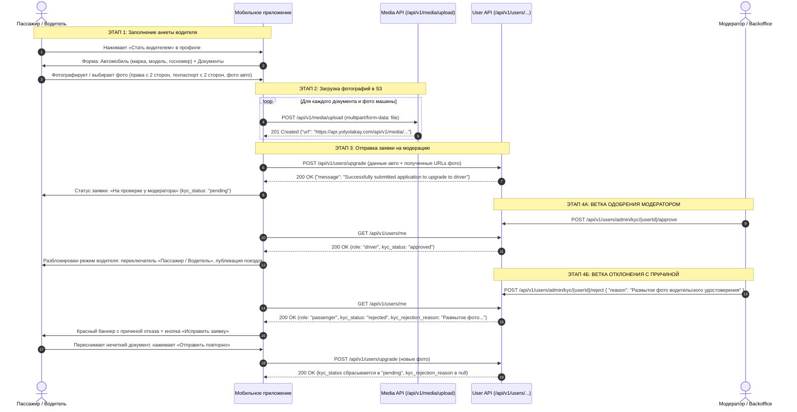

---

### 4.1. Получение данных своего профиля (`GET /api/v1/users/me`)

При каждом холодном старте приложения, авторизации и при переходе на вкладку «Профиль» мобильный клиент запрашивает актуальный профиль пользователя.

* **Метод:** `GET`
* **Адрес (URL):** `https://api.yolyolakay.com/api/v1/users/me`
* **Заголовки:**
  ```http
  Authorization: Bearer <access_token>
  X-Device-ID: e5b7a192-3c4a-4f81-9b1c-32f22b8287d1
  X-OS-Type: android
  ```
* **Успешный ответ бэкенда (`200 OK`):**
  ```json
  {
    "user": {
      "id": "a3d38bbb-eb6c-4c34-a85b-f5b241fa09e3",
      "first_name": "Алишер",
      "last_name": "Усманов",
      "phone_number": "+998901234567",
      "role": "passenger",
      "kyc_status": "rejected",
      "kyc_rejection_reason": "Неразборчивое фото водительского удостоверения. Пожалуйста, сфотографируйте документ при хорошем освещении без бликов.",
      "status": "active",
      "locale": "uz",
      "gender": "male",
      "rating": 4.95,
      "rating_count": 28,
      "avatar_url": "https://api.yolyolakay.com/api/v1/media/avatar_abc.jpg",
      "created_at": "2026-09-08T10:32:24.519Z",
      "updated_at": "2026-09-08T11:15:00.000Z"
    },
    "cars": [
      {
        "id": "b1e2c3d4-5678-90ab-cdef-112233445566",
        "user_id": "a3d38bbb-eb6c-4c34-a85b-f5b241fa09e3",
        "gov_number": "01A777AA",
        "brand": "Chevrolet",
        "model": "Gentra",
        "color": "Черный",
        "year": 2022,
        "moderation_status": "rejected",
        "created_at": "2026-09-08T10:45:00.000Z"
      }
    ]
  }
  ```

#### Значения поля `kyc_status` (Статус водительской верификации):
| Значение | Статус | Поле `kyc_rejection_reason` | Что отображать в UI приложения |
| :--- | :--- | :--- | :--- |
| `none` | Еще не подавал заявку | `null` | Показывать баннер / кнопку: *«Хотите зарабатывать на поездках? Станьте водителем»*. При нажатии открывается мастер регистрации водителя. |
| `pending` | На проверке у модератора | `null` | Показывать информационный желтый бейдж: *«Ваша заявка водителя находится на проверке. Обычно модерация занимает до 2 часов»*. Кнопка создания поездок неактивна. |
| `approved` | Одобрен | `null` | Пользователь получил роль водителя (`role: "driver"`). Показывается переключатель режимов «Пассажир / Водитель». В режиме водителя открывается вкладка создания и управления поездками. |
| `rejected` | Отклонена модератором | Строка с причиной (например, *"Размытое фото прав"*) | **Отображать заметный красный баннер с текстом причины**: <br>❌ *«Заявка на водителя отклонена: {kyc_rejection_reason}»*.<br>Рядом кнопка **«Исправить заявку»**, открывающая форму с сохраненными данными для замены некорректного документа. |

---

### 4.2. Редактирование личных данных профиля (`PATCH /api/v1/users/me`)

Позволяет обновить имя, фамилию, пол, язык интерфейса или аватар пользователя.

* **Метод:** `PATCH` (также поддерживается синоним `PUT /api/v1/users/profile`)
* **Адрес (URL):** `https://api.yolyolakay.com/api/v1/users/me`
* **Заголовки:**
  ```http
  Content-Type: application/json
  Authorization: Bearer <access_token>
  ```
* **Тело запроса (JSON):**
  ```json
  {
    "first_name": "Алишер",
    "last_name": "Усманов",
    "gender": "male",
    "locale": "uz",
    "avatar_url": "https://api.yolyolakay.com/api/v1/media/new_avatar.jpg"
  }
  ```
* **Успешный ответ (`200 OK`):** Возвращает обновленный объект пользователя `User`.

---

### 4.3. Загрузка фотографий через Media Service (`POST /api/v1/media/upload`)

Все медиафайлы (аватар, фото водительских прав с двух сторон, фото техпаспорта, фото автомобиля) загружаются через единый медиа-сервис **до** вызова API обновления профиля или подачи заявки на водителя.

* **Метод:** `POST`
* **Адрес (URL):** `https://api.yolyolakay.com/api/v1/media/upload`
* **Заголовки:**
  ```http
  Authorization: Bearer <access_token>
  Content-Type: multipart/form-data
  ```
* **Параметры Form-Data:**
  * `file`: бинарные данные файла изображения (`image/jpeg`, `image/png`, `image/webp`).
  * *Рекомендация для мобильного клиента:* сжимать фото на стороне клиента перед отправкой (максимальное разрешение 1920x1080, JPEG качество 80-85%), чтобы ускорить загрузку при нестабильном 3G/4G соединении.
* **Успешный ответ (`201 Created`):**
  ```json
  {
    "id": "7b830f32-1234-4567-89ab-cdef01234567",
    "url": "https://api.yolyolakay.com/api/v1/media/file_9a8b7c6d5e.jpg",
    "filename": "file_9a8b7c6d5e.jpg",
    "size": 345120,
    "content_type": "image/jpeg"
  }
  ```
  Полученный `url` сохраняется и передается в поля следующего запроса (`/upgrade` или `/cars`).

---

### 4.4. Подача и исправление заявки на водителя (`POST /api/v1/users/upgrade`)

Используется как для **первичной подачи** заявки на водителя, так и для **повторной отправки после устранения замечаний** модератора.

> [!NOTE]
> При повторной отправке заявки бэкенд автоматически сбрасывает статус `kyc_status` в `"pending"` и очищает поле `kyc_rejection_reason` в `null`.

* **Метод:** `POST`
* **Адрес (URL):** `https://api.yolyolakay.com/api/v1/users/upgrade`
* **Заголовки:**
  ```http
  Content-Type: application/json
  Authorization: Bearer <access_token>
  X-Device-ID: e5b7a192-3c4a-4f81-9b1c-32f22b8287d1
  ```
* **Тело запроса (JSON):**
  ```json
  {
    "brand": "Chevrolet",
    "model": "Gentra",
    "gov_number": "01A777AA",
    "avatar_url": "https://api.yolyolakay.com/api/v1/media/driver_face.jpg",
    "driver_license_front": "https://api.yolyolakay.com/api/v1/media/license_front.jpg",
    "driver_license_back": "https://api.yolyolakay.com/api/v1/media/license_back.jpg",
    "tech_passport_front": "https://api.yolyolakay.com/api/v1/media/tech_front.jpg",
    "tech_passport_back": "https://api.yolyolakay.com/api/v1/media/tech_back.jpg",
    "car_front_photo": "https://api.yolyolakay.com/api/v1/media/car_front.jpg",
    "car_back_photo": "https://api.yolyolakay.com/api/v1/media/car_back.jpg",
    "car_side_photo": "https://api.yolyolakay.com/api/v1/media/car_side.jpg"
  }
  ```

* **Успешный ответ (`200 OK`):**
  ```json
  {
    "message": "Successfully submitted application to upgrade to driver"
  }
  ```

* **Поведение мобильного приложения:**
  * Установить локальный статус пользователя `kyc_status = "pending"`, стереть старый текст ошибки `kyc_rejection_reason = null`;
  * Перевести экран в режим ожидания модерации;
  * Пользователь может продолжать пользоваться приложением как пассажир.

---

### 4.5. Управление автомобилями водителя (`/api/v1/users/me/cars`)

После одобрения заявки водитель может управлять своим автопарком (просмотр, добавление второго авто, изменение данных, удаление).

* **Получить список своих автомобилей:**
  * `GET https://api.yolyolakay.com/api/v1/users/me/cars`
  * Ответ (`200 OK`):
    ```json
    [
      {
        "id": "e3b0c442-98fc-1c14-9afbf4c8996fb924",
        "user_id": "a3d38bbb-eb6c-4c34-a85b-f5b241fa09e3",
        "gov_number": "01A777AA",
        "brand": "Chevrolet",
        "model": "Gentra",
        "color": "Черный",
        "year": 2022,
        "moderation_status": "approved",
        "created_at": "2026-09-08T11:00:00Z"
      }
    ]
    ```

* **Добавить еще один автомобиль:**
  * `POST https://api.yolyolakay.com/api/v1/users/me/cars`
  * Тело запроса (JSON):
    ```json
    {
      "brand": "Chevrolet",
      "model": "Cobalt",
      "gov_number": "01B888BB",
      "color": "Белый",
      "year": 2023,
      "tech_passport_front": "https://api.yolyolakay.com/api/v1/media/tech2_front.jpg",
      "tech_passport_back": "https://api.yolyolakay.com/api/v1/media/tech2_back.jpg"
    }
    ```
  * Ответ (`201 Created`): возвращает добавленный объект автомобиля со статусом `moderation_status: "pending"`.

* **Обновить данные автомобиля:**
  * `PUT /api/v1/users/me/cars/{car_id}` (или `PATCH /api/v1/users/me/cars/{car_id}`)
  * Тело запроса: поля авто, которые требуется обновить.

* **Удалить автомобиль:**
  * `DELETE https://api.yolyolakay.com/api/v1/users/me/cars/{car_id}`
  * Ответ (`200 OK`): `{"message": "Car deleted successfully"}`.

---

## 🔍 СЦЕНАРИЙ 5: ПОИСК МЕЖДУГОРОДНИХ ПОЕЗДОК (ПАССАЖИР)

Пассажир ищет попутную машину между городами или населенными пунктами (например, Ташкент $\rightarrow$ Самарканд) в современном **Map-First** интерфейсе с интерактивной картой и выдвижной нижней шторкой (**BottomSheet**).

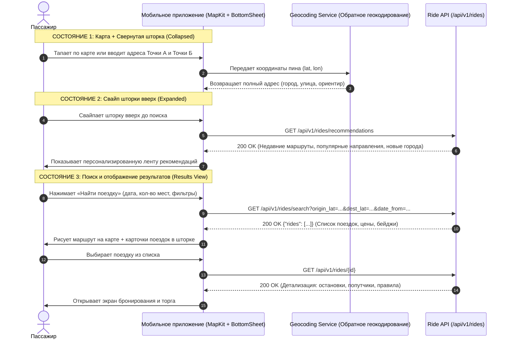

---

### 5.1. Архитектура экрана: Map-First + Интерактивный BottomSheet

Интерфейс поиска строится по схеме **Map-First** (полноэкранная карта подложки) и плавающей шторки **BottomSheet** с тремя состояниями:

#### 1. Слой карты (Fullscreen Map Layer)
* **Технология:** Полноэкранный компонент карты (рекомендуется **Yandex MapKit SDK** для рынка Узбекистана или **Mapbox**).
* **Интерактивность:**
  * Пассажир может двигать карту и ставить маркер отправления (Точка А) или прибытия (Точка Б) прямо пином на карте.
  * **СТРОГОЕ ТРЕБОВАНИЕ К АДРЕСАМ:** В полях ввода и в карточках поездок **ОБЯЗАТЕЛЬНО** должен выводиться **полный адрес с улицей или ориентиром**, а не просто голое название города!
    * ❌ *Неправильно:* `Ташкент`, `Самарканд`.
    * ✅ *Правильно:* `г. Ташкент, метро Чиланзар, стоянка такси` или `г. Самарканд, площадь Регистан`.
  * При перемещении пина мобильное приложение вызывает **Обратное геокодирование (Reverse Geocoding)** и автоматически подставляет отформатированную строку улицы/ориентира в поле ввода.

#### 2. Нижняя панель (BottomSheet Layer) — 3 состояния:

##### А. Свернутое состояние (Collapsed State, занимает ~30–35% экрана)
Отображается по умолчанию при входе на экран поиска:
* **Поле «Откуда» (Точка А):** Текущий город/адрес пользователя (по GPS) или ранее сохраненный адрес. Кнопка «Выбрать на карте» (иконка пина).
* **Поле «Куда» (Точка Б):** Поле ввода адреса назначения с подсказками недавних направлений. Кнопка «Выбрать на карте».
* **Параметры поездки:** Селектор даты (Календарь: «Сегодня», «Завтра», выбор даты) и счетчик мест ($\pm$, по умолчанию 1).
* **Кнопка «Фильтры»:** Фильтр по цене (`price_min`, `price_max`), кондиционеру (`has_ac`), багажу (`has_luggage`), курению (`no_smoking`), ограничению по полу (`gender_restriction`).
* **Главная кнопка действия:** Большая акцентная кнопка **«Найти поездку»**.

##### Б. Развернутое состояние при свайпе вверх (Expanded State — Лента рекомендаций)
Если пользователь еще не нажал кнопку «Найти поездку», но свайпает нижнюю панель вверх, она раскрывается на 85–90% экрана и показывает персонализированный контент:
1. **«Недавние маршруты» (`by_your_routes`):** Карточки маршрутов, по которым пользователь уже ездил ранее. Клик по карточке мгновенно заполняет поля А и Б и запускает поиск в 1 клик.
2. **«Вы недавно смотрели»:** Горизонтальная карусель карточек поездок, которые пользователь открывал за последние 24 часа.
3. **«Для вас: Популярные направления» (`popular`):** Самые востребованные междугородние направления в Узбекистане (например, *Ташкент ⇄ Самарканд*, *Ташкент ⇄ Бухара*, *Ташкент ⇄ Фергана*).
4. **«Новые направления» (`new_directions`):** Города и локации, которые пользователь еще не посещал, с красивыми фотографиями достопримечательностей.

* **API Контракт рекомендаций:**
  * **Метод:** `GET /api/v1/rides/recommendations`
  * **Заголовки:** `Authorization: Bearer <access_token>`
  * **Ответ (`200 OK`):**
    ```json
    {
      "by_your_routes": [
        {
          "from": "г. Ташкент",
          "to": "г. Самарканд",
          "trips_count": 5
        }
      ],
      "popular": [
        {
          "from": "г. Ташкент",
          "to": "г. Бухара",
          "trips_count": 142
        },
        {
          "from": "г. Ташкент",
          "to": "г. Фергана",
          "trips_count": 98
        }
      ],
      "new_directions": [
        {
          "city": "г. Хива",
          "lat": 41.3783,
          "lon": 60.3639
        }
      ]
    }
    ```

##### В. Состояние результатов поиска (Search Results View)
После нажатия кнопки **«Найти поездку»**:
* Карта масштабируется так, чтобы показать линию прямого маршрута между Точкой А и Точкой Б.
* На карте подсвечиваются доступные водители или точки посадки.
* Нижняя шторка фиксируется на половине экрана (50%) с возможностью скролла списка найденных поездок.

---

### 5.2. API Контракт: Поиск поездок (`GET /api/v1/rides/search`)

* **Метод:** `GET`
* **Адрес (URL):** `https://api.yolyolakay.com/api/v1/rides/search`
* **Заголовки:**
  ```http
  Authorization: Bearer <access_token>
  X-Device-ID: e5b7a192-3c4a-4f81-9b1c-32f22b8287d1
  ```
* **Query-параметры запроса:**
  | Параметр | Тип | Обязательный | Описание | Пример |
  | :--- | :--- | :--- | :--- | :--- |
  | `origin_lat` | Float | **Да** | Широта точки отправления | `41.272100` |
  | `origin_lon` | Float | **Да** | Долгота точки отправления | `69.204500` |
  | `dest_lat` | Float | **Да** | Широта точки прибытия | `39.654200` |
  | `dest_lon` | Float | **Да** | Долгота точки прибытия | `66.959700` |
  | `radius_km` | Float | Нет | Радиус поиска в км от точек (по умолчанию 10 км) | `15` |
  | `date_from` | String | Нет | Дата поездки (формат `YYYY-MM-DD` или RFC3339) | `2026-09-09` |
  | `min_seats` | Int | Нет | Минимальное число свободных мест (по умолчанию 1) | `1` |
  | `price_min` | Int | Нет | Минимальная цена за место (в сумах) | `50000` |
  | `price_max` | Int | Нет | Максимальная цена за место (в сумах) | `150000` |
  | `gender_restriction`| String | Нет | Фильтр по полу (`any`, `female`, `male`) | `any` |

* **Пример успешного ответа бэкенда (`200 OK`):**
  ```json
  {
    "rides": [
      {
        "id": "18f2d5e1-8840-410e-a4b5-123456789abc",
        "origin_address": "г. Ташкент, метро Чиланзар, стоянка такси",
        "destination_address": "г. Самарканд, площадь Регистан",
        "origin_lat": 41.2721,
        "origin_lon": 69.2045,
        "destination_lat": 39.6542,
        "destination_lon": 66.9597,
        "departure_time": "2026-09-09T08:00:00Z",
        "total_seats": 4,
        "available_seats": 3,
        "price_per_seat": 120000,
        "is_negotiable": true,
        "has_fair_price_badge": true,
        "gender_restriction": "any",
        "has_ac": true,
        "has_luggage": true,
        "takes_parcels": true,
        "no_smoking": true,
        "no_pets": true,
        "max_two_back": true,
        "pickup_point": "Возле главного выхода из метро Чиланзар",
        "status": "active",
        "driver": {
          "id": "a3d38bbb-eb6c-4c34-a85b-f5b241fa09e3",
          "name": "Алишер Усманов",
          "rating": 4.95,
          "avatar": "https://api.yolyolakay.com/api/v1/media/avatar.jpg"
        },
        "car": {
          "id": "e3b0c442-98fc-1c14-9afbf4c8996fb924",
          "brand": "Chevrolet",
          "model": "Gentra",
          "color": "Белый",
          "license_plate": "01A777AA",
          "year": 2023
        },
        "stops": [
          {
            "address": "г. Джизак, поворот на автовокзал",
            "lat": 40.1158,
            "lon": 67.8422,
            "order_index": 1
          }
        ]
      }
    ]
  }
  ```

#### Элементы карточки поездки в результатах поиска:
1. **Блок водителя:** Аватар, имя, рейтинг с желтой звездой (например, ⭐ `4.95`).
2. **Бейдж «Справедливая цена» (`has_fair_price_badge: true`):** Отображается яркой зеленой/золотой плашкой — гарантирует, что цена водителя находится в пределах рассчитанной системы справедливой рыночной стоимости.
3. **Автомобиль:** Марка, модель, цвет и госномер (например, *Chevrolet Gentra, Белый, 01 A 777 AA*).
4. **Адреса и время:**
   * Время выезда (например, `08:00`) и полный адрес отправления (`г. Ташкент, метро Чиланзар`).
   * Расчетное время прибытия и полный адрес прибытия (`г. Самарканд, площадь Регистан`).
5. **Места:** Число свободных мест (например, *«Свободно 3 из 4 мест»*).
6. **Стоимость:** Крупная цена (например, *«120 000 сум / место»*). Если `is_negotiable: true`, рядом выводится бейдж **«Возможен торг»**.
7. **Иконки удобств:** Снежинка (Кондиционер `has_ac`), Чемодан (Багаж `has_luggage`), Коробка (Берет посылки `takes_parcels`), Перечеркнутая сигарета (`no_smoking`), Два человека сзади (`max_two_back`).

---

### 5.3. Детальный экран поездки (`GET /api/v1/rides/{id}`)

При тапе на карточку открывается подробный экран поездки:
* **Интерактивная карта маршрута:** Отображает полную полилинию пути между точками А и Б с промежуточными точками остановок (`stops`) и точным местом сбора (`pickup_point`).
* **Детальный профиль водителя:** Полное имя, подтвержденные документы (водительское удостоверение, техпаспорт), количество совершенных поездок, отзывы попутчиков.
* **Список попутчиков:** Аватары и имена уже подтвержденных пассажиров в этой машине.
* **Правила в поездке:** Требования к музыке (`music_taste`), перевозка животных (`no_pets`), скорость движения (`driving_speed`).
* **Две кнопки действия внизу экрана:**
  1. **«Забронировать за [Цена] сум»** — стандартное мгновенное бронирование по фиксированной стоимости.
  2. **«Предложить свою цену»** (активна, если `is_negotiable == true`) — открытие всплывающего модального окна торга (Сценарий 6).

---

### 5.4. Автоматический поиск по промежуточным отрезкам и тарификация (Smart Sub-Route Matching)

> [!TIP]
> **Принцип нулевых усилий водителя:** Водителю **НЕ НУЖНО** вручную перечислять промежуточные города (Сырдарья, Джизак и т.д.). Платформа выполняет эту работу **полностью автоматически**!

#### Как это работает для пассажира «Сырдарья $\rightarrow$ Джизак»:
1. **Автоматическое нахождение сквозного маршрута:**
   * Водитель опубликовал поездку `г. Ташкент` $\rightarrow$ `г. Самарканд`.
   * Пассажир ищет: `Откуда: г. Сырдарья` $\rightarrow$ `Куда: г. Джизак`.
   * Бэкенд с помощью пространственного PostGIS-запроса по точкам маршрута сопоставляет вектор движения:
     $$\text{order\_index}(\text{Сырдарья}) < \text{order\_index}(\text{Джизак})$$
   * Поездка водителя отображается в результатах поиска у пассажира с понятной плашкой:
     > 📍 *«Попутный рейс Ташкент $\rightarrow$ Самарканд (посадка в г. Сырдарья, высадка в г. Джизак)»*.
2. **Динамический расчет стоимости за промежуточный отрезок (Dynamic Sub-Pricing):**
   * Система знает общее расстояние маршрута ($D_{\text{total}} = 320\text{ км}$) и цену за весь маршрут ($P_{\text{total}} = 120\,000\text{ сум}$).
   * Система вычисляет расстояние отрезка пассажира ($D_{\text{sub}} = 110\text{ км}$).
   * Рекомендованная стоимость места на отрезке рассчитывается автоматически:
     $$P_{\text{sub}} = P_{\text{total}} \times \frac{D_{\text{sub}}}{D_{\text{total}}} \approx 120\,000 \times \frac{110}{320} \approx 41\,000\text{ сум}$$
   * В карточке пассажир видит стоимость: **40 000 – 45 000 сум**.
   * При этом пассажир также может воспользоваться торгом («Предложить свою цену»), если водитель включил `is_negotiable`.
3. **Уведомление водителю при бронировании:**
   * Водитель получает Push:
     > 🔔 *«Новая попутная заявка: Сырдарья $\rightarrow$ Джизак (1 место, 45 000 сум). Посадка по вашему маршруту»*.

---

### 5.5. Точки высадки: Высадка на трассе против Заезда в город (Highway Drop-off vs City Detour)

Междугородняя магистраль (например, трасса М39 Ташкент $\rightarrow$ Самарканд) огибает центры попутных городов (Джизак, Гулистан). Если водитель следует в Самарканд, заезд в центр промежуточного города требует съезда с трассы, проезда через городские светофоры и пробки, отнимая от 30 до 45 минут времени.

Платформа решает эту задачу через **прозрачную дифференциацию типов высадки**:

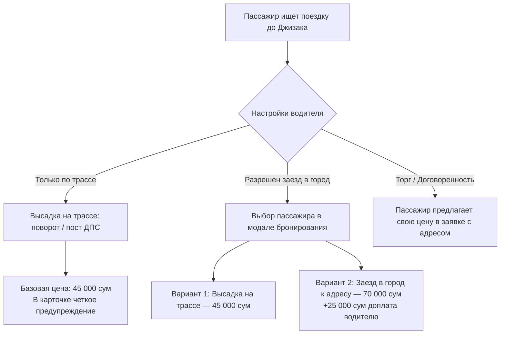

#### 1. Два типа высадки в интерфейсе пассажира:

1. **Тип 1: «Высадка на трассе / Поворот» (`dropoff_type: "highway"`) — По умолчанию:**
   * Опорная локация на магистрали: например, *«г. Джизак, поворот на город / пост ДПС / автовокзал на трассе»*.
   * Водитель не съезжает с трассы и не теряет время.
   * **Отображение в карточке поиска:** Обязательная информационная плашка:  
     > ⚠️ **«Высадка на трассе: г. Джизак (поворот на город)»**  
     > *Водитель следует по маршруту Ташкент $\rightarrow$ Самарканд и не заезжает в центр города. До центра ~5–7 км (местное такси ~10 000 сум).*
   * **Результат:** 100% честность и отсутствие конфликтов во время поездки.

2. **Тип 2: «С заездом в город / До адреса» (`dropoff_type: "city_detour"`):**
   * Водитель съезжает с трассы и довозит пассажира по указанному адресу в черте города.
   * Опция доступна, только если у водителя включен флаг `allows_city_detour: true`.
   * К стоимости отрезка прибавляется фиксированная доплата водителя `city_detour_fee` (например, `+25 000 сум`).

#### 2. Защита интересов сквозных пассажиров (Критическое правило):
* Если в автомобиле **уже есть подтвержденные пассажиры** на полный маршрут (`г. Ташкент` $\rightarrow$ `г. Самарканд`), глубокий заезд в попутные города **автоматически блокируется платформой**!
* Это гарантирует, что водитель не заставит пассажиров Самарканда терять 40 минут в пробках Джизака. Доступна только экспресс-высадка на трассе.
* Если машина свободна или везет пассажиров только до Джизака — заезд в город разрешен.

#### 3. Торг с указанием адреса (Bidding with Custom Drop-off):
Если пассажиру очень нужно доехать до конкретной точки в городе, а водитель едет по трассе:
* В поле бронирования пассажир выбирает «Предложить свою цену»:
  * `offered_price`: `70000` (вместо базовых 45 000).
  * `pickup_preference`: *«Завезите, пожалуйста, к Ж/Д вокзалу Джизака (+25 000 сум доплата)»*.
* Водитель видит предложение с конкретной точкой на карте и решает сам — принять или отклонить.

---

## 🤝 СЦЕНАРИЙ 6: БРОНИРОВАНИЕ, ТОРГИ И ПРАВИЛА ОТМЕНЫ ПОЕЗДКИ (BOOKING, BIDDING & CANCELLATION)

Сценарий охватывает подачу заявки пассажиром, период ожидания и сбора клиентов водителем, а также **строгие бизнес-правила отмены поездки**.

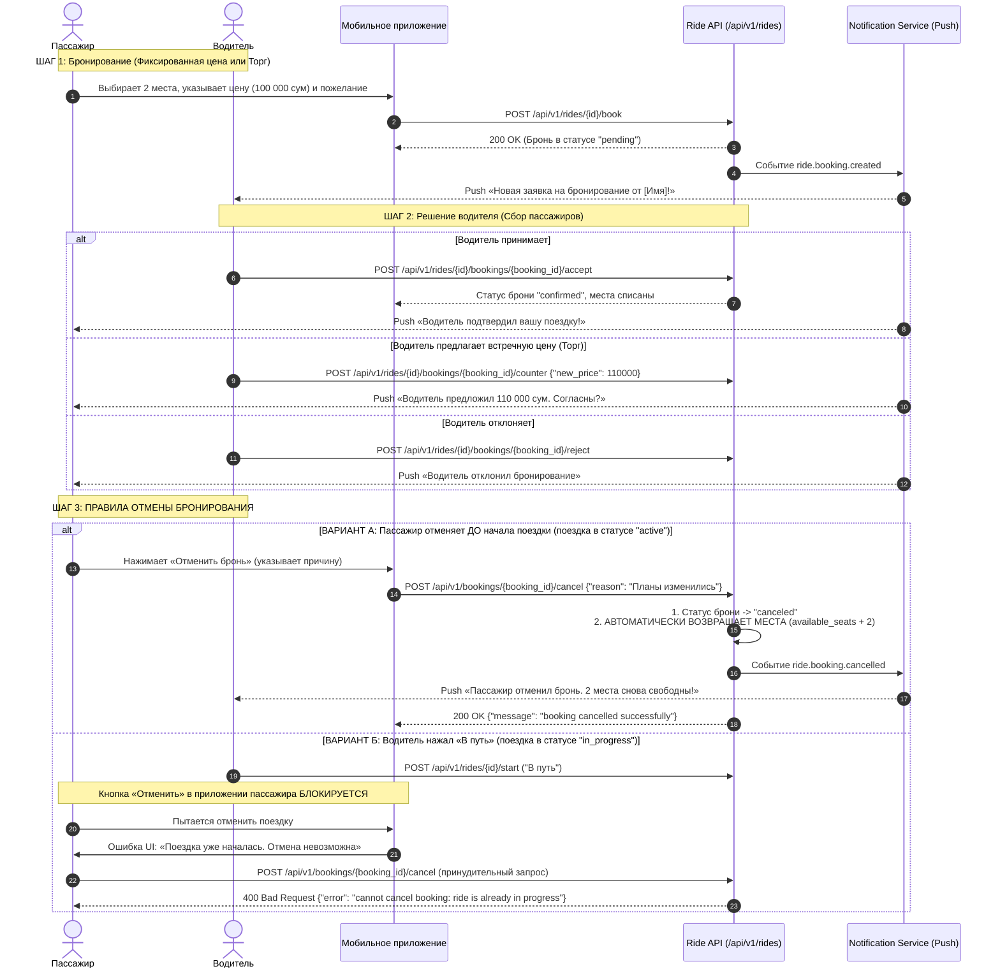

---

### 6.1. Отправка заявки на бронирование (`POST /rides/{id}/book`)

* **Метод:** `POST`
* **Адрес (URL):** `https://api.yolyolakay.com/api/v1/rides/{id}/book`
* **Заголовки:**
  ```http
  Content-Type: application/json
  Authorization: Bearer <access_token пассажира>
  ```
* **Тело запроса (JSON):**
  ```json
  {
    "seats": 2,
    "is_full_car_buyout": false,
    "offered_price": 100000.0,
    "pickup_preference": "Заберите меня возле гостиницы Узбекистан",
    "dropoff_type": "highway"
  }
  ```
  * `seats`: количество бронируемых мест (от 1 до `available_seats`).
  * `is_full_car_buyout`: `true`, если пассажир выкупает всю машину целиком (все оставшиеся свободные места).
  * `offered_price`: опционально, предлагаемая пассажиром цена за 1 место. Если не передано — берется фиксированная цена водителя `price_per_seat`.
  * `pickup_preference`: текстовое примечание с точным ориентиром посадки / высадки.
  * `dropoff_type`: опционально, `"highway"` (высадка на трассе/повороте, по умолчанию) или `"city_detour"` (с заездом вглубь города по адресу, доступно если водитель разрешил заезд).

* **Валидация бэкенда при создании бронирования:**
  * Пассажир **не может** забронировать свою собственную поездку (`cannot book your own ride`).
  * Пассажир **не может** создать дублирующую бронь на ту же поездку, если у него уже есть активная бронь (`you already have an active booking for this ride`).
  * Нельзя запросить больше мест, чем вместимость авто или текущий остаток свободных мест (`not enough available seats`).
  * Проверка гендерных ограничений поездки (`gender_restriction`): если поездка помечена `female`, бронировать могут только подтвержденные женщины.

* **Успешный ответ (`200 OK`):**
  ```json
  {
    "message": "ride booked successfully",
    "booking": {
      "id": "8c456789-1234-5678-9abc-def012345678",
      "ride_id": "18f2d5e1-8840-410e-a4b5-123456789abc",
      "passenger_id": "a3d38bbb-eb6c-4c34-a85b-f5b241fa09e3",
      "seats_booked": 2,
      "total_price": 200000,
      "offered_price": 100000,
      "status": "pending",
      "created_at": "2026-09-08T12:50:00Z"
    }
  }
  ```

---

### 6.2. Реакция водителя на заявку (Этап сбора пассажиров)

Водитель в шторке управления поездкой видит список заявок от пассажиров:

1. **Принять заявку (`accept`):**
   * `POST https://api.yolyolakay.com/api/v1/rides/{id}/bookings/{booking_id}/accept`
   * Статус брони меняется на `"confirmed"`.
   * **Число свободных мест в поездке автоматически уменьшается** на `seats_booked` (`available_seats = available_seats - seats_booked`).
   * Пассажир получает мгновенный Push: *«Водитель подтвердил вашу бронь! Готовьтесь к поездке»*.

2. **Отклонить заявку (`reject`):**
   * `POST https://api.yolyolakay.com/api/v1/rides/{id}/bookings/{booking_id}/reject`
   * Статус брони меняется на `"rejected"`. Пассажир получает уведомление об отказе.

3. **Предложить свою цену — Торг (`counter`):**
   * `POST https://api.yolyolakay.com/api/v1/rides/{id}/bookings/{booking_id}/counter`
   * Тело запроса:
     ```json
     {
       "new_price": 110000
     }
     ```
   * Пассажир получает Push: *«Водитель предложил 110 000 сум за место. Принять предложение?»* и может подтвердить или отклонить новую цену в приложении.

---

### 6.3. КРИТИЧЕСКИЕ ПРАВИЛА ОТМЕНЫ БРОНИРОВАНИЯ (CANCELLATION RULES)

> [!IMPORTANT]
> **Обязательные требования к мобильному приложению и бэкенду при отмене:**
> 1. При отмене брони пассажиром до выезда места **ОБЯЗАТЕЛЬНО должны моментально освобождаться** в поездке.
> 2. Водитель **ОБЯЗАТЕЛЬНО должен получать мгновенное Push-уведомление** об отмене.
> 3. После того как водитель нажал **«В путь»** (`status = "in_progress"`), отмена поездки пассажирам **КАТЕГОРИЧЕСКИ ЗАПРЕЩЕНА**!

#### СЛУЧАЙ 1: Отмена пассажиром ДО начала поездки (Статус поездки `active`)
Если у пассажира изменились обстоятельства, он может отменить бронь:

* **Метод:** `POST`
* **Адрес (URL):** `https://api.yolyolakay.com/api/v1/bookings/{booking_id}/cancel` (или `https://api.yolyolakay.com/api/v1/rides/{ride_id}/bookings/{booking_id}/cancel`)
* **Заголовки:**
  ```http
  Content-Type: application/json
  Authorization: Bearer <access_token пассажира>
  ```
* **Тело запроса (JSON):**
  ```json
  {
    "reason": "Изменились планы / не успеваю на посадку"
  }
  ```

* **Что делает бэкенд в единой атомарной транзакции базы данных:**
  1. **Фиксация отмены:** Статус брони меняется на `"canceled"`, фиксируется точное время отмены и причина `cancellation_reason`.
  2. **АВТОМАТИЧЕСКОЕ ОСВОБОЖДЕНИЕ МЕСТ:** Если бронь была подтверждена (`confirmed`), бэкенд немедленно восстанавливает свободные места в поездке:
     $$\text{available\_seats} = \text{available\_seats} + \text{seats\_booked}$$
     Поездка моментально обновляет счетчик доступных мест в общей ленте поиска, и освободившиеся места снова могут забронировать другие пассажиры!
  3. **МГНОВЕННОЕ УВЕДОМЛЕНИЕ ВОДИТЕЛЯ:** Бэкенд генерирует событие `ride.booking.cancelled` в RabbitMQ. Notification Service отправляет водителю Push-уведомление на узбекском или русском языке:
     > 🔔 *«Пассажир [Имя Фамилия] отменил бронирование (2 мест). Места снова доступны для поиска и бронирования»*.

* **Успешный ответ (`200 OK`):**
  ```json
  {
    "message": "booking cancelled successfully"
  }
  ```

---

#### СЛУЧАЙ 2: СТРОГИЙ ЗАПРЕТ отмены ПОСЛЕ старта поездки («В путь» / `status = "in_progress"`)

Как только водитель собрал пассажиров и нажал в приложении кнопку **«В путь»** (`POST /api/v1/rides/{id}/start`), статус поездки становится `"in_progress"`:

1. **Поведение в Мобильном Приложении Пассажира:**
   * Кнопка «Отменить поездку» в интерфейсе **полностью скрывается** или переводится в состояние **Disabled** (неактивна и затенена серым цветом).
   * При тапе по неактивной кнопке или попытке вызова контекстного меню отображается системный модал/алерт:
     > ⚠️ **«Поездка уже началась»**  
     > *Водитель уже нажал «В путь» и находится на маршруте. Отменить бронирование через приложение невозможно. Если у вас возникла экстренная ситуация, пожалуйста, свяжитесь напрямую с водителем или обратитесь в службу поддержки платформы.*

2. **Защита на уровне Бэкенда (Hard Security Enforcement):**
   * Если клиентское приложение или сторонний скрипт попытается отправить `POST /api/v1/bookings/{booking_id}/cancel`, метод репозитория `CancelBookingTx` проверяет статус связанной поездки:
     ```go
     if pgRide.Status == "in_progress" {
         return nil, errors.New("cannot cancel booking: ride is already in progress")
     }
     if pgRide.Status == "completed" {
         return nil, errors.New("cannot cancel booking: ride is already completed")
     }
     ```
   * **Ответ бэкенда (`400 Bad Request`):**
     ```json
     {
       "error": "cannot cancel booking: ride is already in progress"
     }
     ```
   * Отмена транзакции базы данных отклоняется, статус бронирования и места остаются неизменными.

---

## 🚗 СЦЕНАРИЙ 7: ПУБЛИКАЦИЯ ПОЕЗДКИ, ОЖИДАНИЕ КЛИЕНТОВ И УПРАВЛЕНИЕ МАРШРУТОМ (ВОДИТЕЛЬ)

Водитель планирует поездку между городами, задает точные адреса, цену за место, публикует поездку, ожидает бронирований, нажимает **«В путь»** и ведет онлайн-телематику.

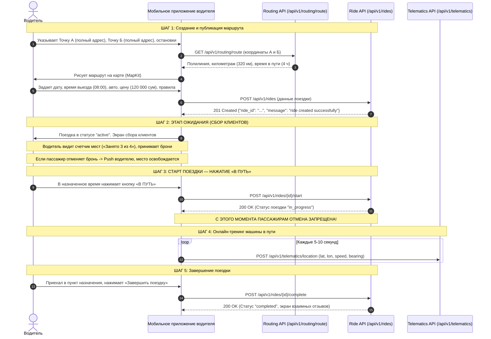

---

### 7.1. Пошаговый процесс публикации поездки (`POST /api/v1/rides`)

Публикация поездки состоит из удобного 3-шагового мастера (Wizard):

#### Шаг 1: Выбор маршрута на интерактивной карте (с автоматической генерацией остановок)
* Водитель указывает **только две основные точки**: **Точку А (Откуда)** и **Точку Б (Куда)**:
  * Перемещением пина на интерактивной карте или выбором адреса из подсказок.
  * **ОБЯЗАТЕЛЬНОСТЬ АДРЕСА:** Применяется обратное геокодирование с точной улицей/ориентиром (например, `г. Ташкент, стоянка м. Чиланзар` $\rightarrow$ `г. Самарканд, ж/д вокзал`).
* **АВТОМАТИЧЕСКАЯ ГЕНЕРАЦИЯ `ride_stops` (Нулевые усилия для водителя):**
  * Водителю **НЕ НУЖНО** вручную вспоминать и печатать названия десятков попутных поселков и городов!
  * Приложение обращается к сервису маршрутизации (`GET /api/v1/routing/route`), строит точную полилинию трассы (например, трасса М39), рассчитывает километраж (320 км) и время в пути (4 ч).
  * **Бэкенд автоматически анализирует трассу** и определяет все ключевые населенные пункты и транспортные развязки, лежащие в коридоре движения (например: *г. Чиназ $\rightarrow$ г. Сырдарья $\rightarrow$ г. Джизак $\rightarrow$ г. Галляарал*), и **автоматически записывает их в таблицу `ride_stops`** с порядковыми номерами (`order_index`).
  * **Интерфейс водителя:** Водителю отображается информационная плашка:  
    > 🛣️ *«Маршрут охватывает попутные города: Чиназ, Сырдарья, Джизак. Пассажиры из этих городов смогут автоматически находить вашу машину и подсаживаться по пути»*.  
    > *(Опциональный тумблер: «Экспресс: еду без попутных остановок» — если водитель торопится и не хочет подбирать людей на трассе).*
* При необходимости водитель может добавить свою уникальную кастомную точку сбора/высадки (`stops`).

#### Шаг 2: Дата и точное время отправления
* Водитель выбирает точную дату и время выезда (`departure_time`), например: `09.09.2026 в 07:30`.
* Указывает точное место сбора пассажиров (`pickup_point`): например, *«Возле главного входа в метро Чиланзар, белый навес»*.

#### Шаг 3: Автомобиль, места, цена и правила комфорта
* **Выбор авто (`vehicle_id`):** Выбирается из списка подтвержденных машин водителя (полученных через `GET /api/v1/users/me/cars`).
* **Количество мест (`total_seats`):** Число свободных мест для посадки пассажиров (обычно от 1 до 4).
* **Стоимость за 1 место (`price_per_seat`):** Указывается в сумах (например, `120000`).
  * Приложение показывает рекомендованный диапазон цены платформы (подсказка: *«При цене до 130 000 сум ваша поездка получит бейдж "Справедливая цена" и будет выше в выдаче»*).
* **Переключатель «Возможен торг» (`is_negotiable`):** Включение/отключение разрешения пассажирам предлагать свою цену.
* **Ограничение по полу (`gender_restriction`):** `any` (все пассажиры), `female` (только женщины), `male` (только мужчины).
* **Опции поездки и комфорт:**
  * Заезд в попутные города (`allows_city_detour: true/false`): готовность съехать с трассы вглубь промежуточного города (например, в центр Джизака);
  * Доплата за заезд в город (`city_detour_fee: 25000`): фиксированная надбавка в сумах к стоимости отрезка за заезд к адресу;
  * Кондиционер (`has_ac: true/false`);
  * Вместительный багаж (`has_luggage: true/false`);
  * Готовность брать посылки (`takes_parcels: true/false`);
  * Не курить в салоне (`no_smoking: true/false`);
  * Без домашних животных (`no_pets: true/false`);
  * Не более двух человек на заднем сиденье (`max_two_back: true/false`);
  * Предпочтения по музыке (`music_taste`): например, *«Спокойная фоновая музыка, ретро»*;
  * Стиль вождения (`driving_speed`): `slow` / `moderate` / `fast`.

* **API Контракт: Создание поездки (`POST /api/v1/rides`)**
  * **Метод:** `POST`
  * **Адрес (URL):** `https://api.yolyolakay.com/api/v1/rides`
  * **Заголовки:**
    ```http
    Content-Type: application/json
    Authorization: Bearer <access_token водителя>
    X-Device-ID: e5b7a192-3c4a-4f81-9b1c-32f22b8287d1
    ```
  * **Тело запроса (JSON):**
    ```json
    {
      "vehicle_id": "e3b0c442-98fc-1c14-9afbf4c8996fb924",
      "origin_lat": 41.2721,
      "origin_lon": 69.2045,
      "destination_lat": 39.6542,
      "destination_lon": 66.9597,
      "origin_address": "г. Ташкент, стоянка м. Чиланзар",
      "destination_address": "г. Самарканд, ж/д вокзал",
      "departure_time": "2026-09-09T07:30:00Z",
      "total_seats": 4,
      "price_per_seat": 120000,
      "is_negotiable": true,
      "allows_city_detour": true,
      "city_detour_fee": 25000,
      "gender_restriction": "any",
      "has_ac": true,
      "has_luggage": true,
      "takes_parcels": true,
      "no_smoking": true,
      "no_pets": true,
      "driving_speed": "moderate",
      "max_two_back": true,
      "pickup_point": "Возле главного входа в метро Чиланзар",
      "music_taste": "Спокойная фоновая музыка",
      "stops": [
        {
          "lat": 40.1158,
          "lon": 67.8422,
          "address": "г. Джизак, поворот на автовокзал"
        }
      ]
    }
    ```
  * **Успешный ответ (`201 Created`):**
    ```json
    {
      "message": "ride created successfully",
      "ride_id": "18f2d5e1-8840-410e-a4b5-123456789abc"
    }
    ```

---

### 7.2. Этап ожидания: Сбор клиентов (Waiting & Gathering Phase)

После создания поездки водитель переходит на экран активной поездки (`status: "active"`):
1. **Счетчик заполненности салона:**
   В верхней части отображается графический индикатор машины: например, *«Занято 3 из 4 мест»* (`available_seats: 1`).
2. **Входящие заявки на бронирование:**
   * Список пассажиров, ожидающих подтверждения (`status: "pending"`).
   * По каждому пассажиру видно имя, аватар, рейтинг, количество запрашиваемых мест и предложенную цену.
   * Кнопки действий: **«Принять»**, **«Отклонить»**, **«Предложить свою цену»** (Торг).
3. **Обработка отмены брони клиентом:**
   * Если кто-то из подтвержденных пассажиров отменяет бронь, водителю моментально приходит push-уведомление.
   * Количество свободных мест в карточке увеличивается, и поездка автоматически остается в ленте поиска для донабора пассажиров.
4. **Связь с пассажирами:**
   В карточке подтвержденного пассажира доступны кнопки «Позвонить» (по маскированному номеру) и «Написать в чат».

---

### 7.3. Старт поездки — Кнопка «В путь» (`POST /api/v1/rides/{id}/start`)

В день и время выезда водитель прибывает на место посадки, собирает пассажиров и нажимает главную кнопку действия: **«В ПУТЬ»**.

* **Метод:** `POST`
* **Адрес (URL):** `https://api.yolyolakay.com/api/v1/rides/{id}/start`
* **Заголовки:** `Authorization: Bearer <access_token водителя>`
* **Что происходит в системе:**
  1. Статус поездки переключается с `"active"` на `"in_progress"`.
  2. **С ЭТОГО МОМЕНТА ДЛЯ ВСЕХ ПАССАЖИРОВ ОТМЕНА БРОНИРОВАНИЯ ПОЛНОСТЬЮ БЛОКИРУЕТСЯ!** Кнопки отмены в интерфейсе становятся неактивными, а бэкенд возвращает ошибку `400 Bad Request` при любой попытке вызова эндпоинта отмены.
  3. Всем подтвержденным пассажирам отправляется Push-уведомление:
     > 🚀 *«Поездка началась! Водитель выехал по маршруту. Счастливого пути!»*
  4. Приложение водителя автоматически запускает фоновую службу геолокации (Telematics).

* **Успешный ответ (`200 OK`):**
  ```json
  {
    "message": "ride started successfully"
  }
  ```

---

### 7.4. Передача геопозиции в реальном времени (Telematics)

Во время движения (`status: "in_progress"`) мобильное приложение водителя отправляет координаты GPS в фоновом режиме каждые 5–10 секунд:

* **Метод:** `POST`
* **Адрес (URL):** `https://api.yolyolakay.com/api/v1/telematics/location`
* **Заголовки:** `Authorization: Bearer <access_token водителя>`
* **Тело запроса (JSON):**
  ```json
  {
    "ride_id": "18f2d5e1-8840-410e-a4b5-123456789abc",
    "lat": 41.2054,
    "lon": 69.1532,
    "speed": 75.5,
    "bearing": 210.0
  }
  ```
Пассажиры в своем приложении видят плавное перемещение иконки машины на интерактивной карте по маршруту в реальном времени (через `GET /api/v1/rides/{id}/driver-location` или WebSocket канал).

---

### 7.5. Завершение поездки (`POST /api/v1/rides/{id}/complete`)

По прибытии в конечный пункт назначения (Точка Б) водитель нажимает кнопку **«Завершить поездку»**:

* **Метод:** `POST`
* **Адрес (URL):** `https://api.yolyolakay.com/api/v1/rides/{id}/complete`
* **Заголовки:** `Authorization: Bearer <access_token водителя>`
* **Что происходит в системе:**
  1. Статус поездки переходит в `"completed"`.
  2. Фоновая передача телематики отключается.
  3. Сумма поездки зачисляется в статистику заработка водителя (`GET /api/v1/rides/earnings`).
  4. Пассажирам и водителю открывается экран взаимной оценки (выставление от 1 до 5 звезд и написание отзыва).

* **Успешный ответ (`200 OK`):**
  ```json
  {
    "message": "ride completed successfully"
  }
  ```

---

### 7.6. Отмена поездки водителем (Driver Ride Cancellation)

Водитель может отменить свою поездку в любой момент до её завершения (в статусах `draft`, `active`, `in_progress`), например, при непредвиденных обстоятельствах или технической поломке автомобиля.

#### 1. API Контракт: Отмена поездки
* **Метод:** `POST` (или стандартный REST `DELETE`)
* **Адрес (URL):**
  * `https://api.yolyolakay.com/api/v1/rides/{id}/cancel` (канонический)
  * `https://api.yolyolakay.com/api/v1/rides/{id}` (поддерживается также метод `DELETE`)
* **Заголовки:**
  ```http
  Authorization: Bearer <access_token_водителя>
  Content-Type: application/json
  ```
* **Тело запроса (JSON, опционально):**
  ```json
  {
    "reason": "Поломка автомобиля / изменились планы"
  }
  ```
  *(При использовании `DELETE` причину можно также передавать в query: `?reason=Поломка+автомобиля`).*

* **Что делает бэкенд в единой атомарной транзакции:**
  1. **Смена статуса поездки:** статус переходит в `"cancelled"`.
  2. **Каскадная отмена всех бронирований:** все подтверждённые (`confirmed`) и ожидающие (`pending`) бронирования пассажиров автоматически отменяются (`status = "canceled"`).
  3. **Возврат лимита водителю:** если поездка была активирована (`active` или `in_progress`), водителю автоматически начисляется возврат лимита поездки (`RefundRideLimit`) на баланс подписки.
  4. **Мгновенное оповещение пассажиров:** генерируется событие `ride.cancelled` в RabbitMQ, и всем затронутым пассажирам отправляются Push-уведомления об отмене рейса.
  5. **Очистка кеша:** поисковый кеш в Redis инвалидируется, поездка моментально пропадает из общей ленты поиска.

* **Успешный ответ (`200 OK`):**
  ```json
  {
    "message": "ride cancelled successfully"
  }
  ```

* **Возможные ошибки:**
  * `401 Unauthorized` — токен отсутствует или истёк (`missing token` / `invalid or expired token`). См. ниже решение через Refresh Interceptor.
  * `400 Bad Request` — `unauthorized: you are not the driver of this ride` (попытка отменить поездку чужим пользователем или пассажиром).

---

#### 2. КРИТИЧЕСКИ ВАЖНО: Устранение ошибки 401 в Мобильном Приложении (Refresh Token Interceptor)

> [!WARNING]
> Если мобильное приложение не перехватывает истечение короткоживущего `access_token` (1 час), запросы к `/api/v1/rides/my` завершаются с ошибкой `401 Unauthorized: missing token`. Водитель видит пустой экран или ошибку, не может открыть детали поездки и нажать «Отменить».

В сетевом клиенте мобильного приложения (Flutter Dio / Http) **ОБЯЗАТЕЛЬНО** должен быть настроен автоматический перехватчик `401`:

```dart
// Пример Refresh Interceptor для Flutter (Dio)
class AuthInterceptor extends QueuedInterceptor {
  final Dio dio;
  final SecureStorage storage;

  AuthInterceptor(this.dio, this.storage);

  @override
  void onRequest(RequestOptions options, RequestInterceptorHandler handler) async {
    final token = await storage.getAccessToken();
    if (token != null && token.isNotEmpty) {
      options.headers['Authorization'] = 'Bearer $token';
    }
    handler.next(options);
  }

  @override
  void onError(DioException err, ErrorInterceptorHandler handler) async {
    if (err.response?.statusCode == 401) {
      final refreshToken = await storage.getRefreshToken();
      if (refreshToken != null && refreshToken.isNotEmpty) {
        try {
          // Запрос на обновление пары токенов
          final refreshDio = Dio();
          final response = await refreshDio.post(
            'https://api.yolyolakay.com/api/v1/auth/refresh',
            data: {'refresh_token': refreshToken},
          );

          if (response.statusCode == 200) {
            final newAccessToken = response.data['access_token'];
            final newRefreshToken = response.data['refresh_token'];
            await storage.saveTokens(newAccessToken, newRefreshToken);

            // Повторяем исходный упавший запрос с новым токеном
            err.requestOptions.headers['Authorization'] = 'Bearer $newAccessToken';
            final retryResponse = await dio.fetch(err.requestOptions);
            return handler.resolve(retryResponse);
          }
        } catch (_) {
          // Истёк сам refresh_token -> разлогиниваем на экран входа
          await storage.clearTokens();
        }
      }
    }
    handler.next(err);
  }
}
```

---

## 📦 СЦЕНАРИЙ 8: ДОСТАВКА ПОПУТНЫХ ПОСЫЛОК (PARCELS DELIVERY)

Клиент (отправитель) может передать посылку, документы или груз попутному водителю для быстрой междугородней доставки, не заказывая пассажирское место в салоне.

> [!IMPORTANT]
> **Принцип полной зеркальности с поездками («Точь-в-точь»):**  
> Доставка посылок полностью повторяет архитектуру пассажирских поездок:
> 1. **Map-First интерфейс:** полноэкранная карта с вводом точных адресов (улицы/ориентиры) через Reverse Geocoding.
> 2. **Попутные промежуточные города (`ride_stops`):** если водитель едет Ташкент $\rightarrow$ Самарканд, платформа автоматически позволяет ему брать посылки на отрезках (например, Сырдарья $\rightarrow$ Джизак).
> 3. **Точки передачи:** высадка/забор на трассе (базовая цена) или заезд до двери адресата (с доплатой `city_detour_fee`).
> 4. **Обязательные данные получателя:** отправитель указывает имя и телефон получателя; телефон надежно шифруется (AES-GCM-256) и открывается водителю только после закрепления заказа.
> 5. **СТРОГИЕ ПРАВИЛА ОТМЕНЫ:** до передачи груза отмена разрешена с освобождением места в багажнике; **после того как водитель забрал груз («В путь» / `picked_up`), отмена КАТЕГОРИЧЕСКИ ЗАПРЕЩЕНА!**

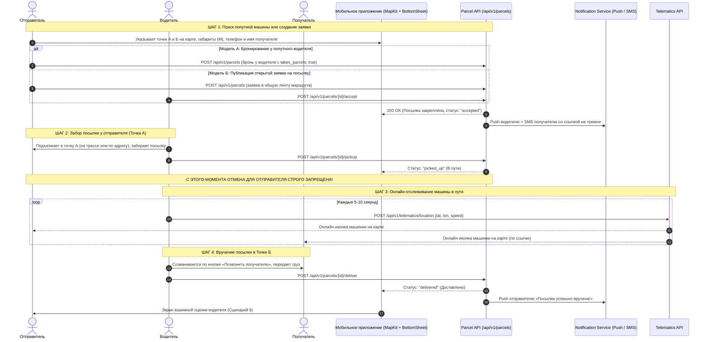

---

### 8.1. Архитектура экрана отправки: Map-First + BottomSheet

Интерфейс отправки посылки строится точно так же, как поиск поездки в Сценарии 5:

#### 1. Полноэкранная интерактивная карта (Fullscreen Map Layer)
* Отправитель перемещает маркеры или выбирает на карте:
  * **Точка А (Откуда забрать):** точный адрес с улицей и ориентиром (например, `г. Ташкент, стоянка м. Чиланзар`);
  * **Точка Б (Куда доставить):** точный адрес назначения (например, `г. Самарканд, ж/д вокзал`).
* **Обратное геокодирование:** при перемещении пина адрес автоматически расшифровывается в человекочитаемую строку.

#### 2. Нижняя шторка (BottomSheet Layer)
* **Поля адресов А и Б** с кнопками «Выбрать на карте»;
* **Селектор габаритов груза** (3 категории);
* **Блок получателя:** номер телефона и имя;
* **Переключатель места передачи:**  
  * 🔘 *На трассе / Поворот в город* (базовая цена);  
  * 🔘 *До двери получателя по адресу* (с доплатой за заезд в город);
* **Стоимость доставки:** рассчитанная системой справедливая цена с возможностью торга (`is_negotiable`).

---

### 8.2. Габариты груза и обязательные данные получателя

#### 1. Категории габаритов (`size`):
* ✉️ **`small` (Конверт / Документы / Ключи):** вес до 1 кг. Помещается в бардачок или карман сиденья. Самый дешевый тариф.
* 📦 **`medium` (Коробка / Пакет с вещами):** вес до 5 кг, размеры до обувной коробки. Помещается под сиденье или в багажник.
* 🧳 **`large` (Чемодан / Крупная коробка / Мешок):** вес до 15 кг. Занимает отдельное багажное отделение.

#### 2. Обязательные данные получателя:
* **Телефон получателя (`receiver_phone`):** обязательное поле в формате `+998XXXXXXXXX`.
* **Имя получателя (`receiver_name`):** например, `Дилшод` — чтобы водитель знал, как обратиться к человеку при звонке.
* **Безопасность и защита от спама:**
  * Номер телефона шифруется в базе данных алгоритмом **AES-GCM-256** (`receiver_phone_encrypted`).
  * В общем поиске номер телефона **полностью скрыт** от посторонних лиц.
  * Номер расшифровывается и открывается водителю **только после принятия заказа в работу** (`accepted`).

---

### 8.3. Две модели отправки посылки

Платформа поддерживает 2 удобных варианта взаимодействия:

#### Вариант 1: Бронирование у попутного водителя (Direct Match)
* Отправитель видит в поисковой выдаче карточки водителей, у которых включена опция `takes_parcels: true` (берет посылки).
* Отправитель выбирает водителя, подходящее время выезда и бронирует доставку.

#### Вариант 2: Публикация открытой заявки на посылку (`POST /api/v1/parcels`)
* Если прямо сейчас нет подходящей машины, отправитель публикует открытую заявку в систему.
* Водители, публикующие поездки по этому маршруту (включая промежуточные города по трассе через авто-остановки `ride_stops`), видят доступные посылки и берут их в 1 клик.

* **API Контракт: Создание заявки на посылку (`POST /api/v1/parcels`):**
  * **Метод:** `POST`
  * **Адрес (URL):** `https://api.yolyolakay.com/api/v1/parcels`
  * **Заголовки:**
    ```http
    Content-Type: application/json
    Authorization: Bearer <access_token отправителя>
    ```
  * **Тело запроса (JSON):**
    ```json
    {
      "from_address": "г. Ташкент, метро Чиланзар, стоянка",
      "to_address": "г. Самарканд, ж/д вокзал",
      "origin_lat": 41.2721,
      "origin_lon": 69.2045,
      "destination_lat": 39.6542,
      "destination_lon": 66.9597,
      "receiver_phone": "+998901234567",
      "receiver_name": "Дилшод",
      "size": "medium",
      "price": 80000,
      "dropoff_type": "highway",
      "description": "Коробка с документами и образцами тканей, вес около 3 кг",
      "deliver_by": "2026-09-09T18:00:00Z"
    }
    ```
  * **Успешный ответ (`201 Created`):**
    ```json
    {
      "id": "c1a2b3c4-5678-90ab-cdef-1234567890ab",
      "status": "pending",
      "from_address": "г. Ташкент, метро Чиланзар, стоянка",
      "to_address": "г. Самарканд, ж/д вокзал",
      "receiver_name": "Дилшод",
      "receiver_phone": "+998901234567",
      "price": 80000,
      "size": "medium",
      "dropoff_type": "highway",
      "created_at": "2026-09-08T13:00:00Z"
    }
    ```

---

### 8.4. Точки передачи и тарификация (Трасса vs Заезд к получателю)

Точно так же, как в Сценарии 5.5 для пассажиров:
1. **Высадка/вручение на трассе (`dropoff_type: "highway"`):**
   * Получатель встречает водителя на магистрали (поворот в город, пост ДПС, автостанция на трассе).
   * Водитель не съезжает с трассы и не теряет время. Базовый тариф.
2. **Доставка до двери адресата (`dropoff_type: "city_detour"`):**
   * Водитель съезжает с трассы в черту города и передает посылку по точному адресу получателя.
   * К стоимости доставки автоматически прибавляется фиксированная доплата водителя `city_detour_fee` (например, `+25 000 сум`).
3. **Торги по цене (`is_negotiable`):**
   * Отправитель может предложить свою цену (`offered_price`), а водитель может принять предложение или выставить встречную цену (`POST /api/v1/parcels/{id}/counter`).

---

### 8.5. КРИТИЧЕСКИЕ ПРАВИЛА ОТМЕНЫ ДОСТАВКИ (CANCELLATION RULES)

> [!IMPORTANT]
> **Обязательные требования к мобильному приложению и бэкенду:**
> 1. До того как водитель забрал посылку, отмена разрешена, место под груз освобождается.
> 2. После того как водитель забрал груз («Посылка у водителя / В пути» — `picked_up` / `in_transit`), **ОТМЕНА КАТЕГОРИЧЕСКИ ЗАПРЕЩЕНА!**

#### СЛУЧАЙ 1: Отмена ДО забора посылки (Статус `pending` или `accepted`)
Если у отправителя изменились планы до встречи с водителем:
* **Метод:** `POST /api/v1/parcels/{id}/cancel`
* **Что происходит в системе:**
  1. Статус посылки меняется на `"canceled"`.
  2. Место под багаж у водителя мгновенно освобождается.
  3. Водитель получает Push-уведомление: *«Отправитель отменил доставку посылки Ташкент $\rightarrow$ Самарканд»*.

#### СЛУЧАЙ 2: СТРОГИЙ ЗАПРЕТ отмены ПОСЛЕ забора груза («В пути» / `status = "picked_up"`)
Как только водитель встретился с отправителем, проверил посылку и нажал кнопку **«Забрал посылку»** (`POST /api/v1/parcels/{id}/pickup`), статус меняется на `"picked_up"` (или рейс переходит в `"in_transit"`):

1. **В интерфейсе приложения отправителя:**
   * Кнопка «Отменить доставку» **полностью скрывается** или переводится в состояние **Disabled** (неактивна).
   * При тапе по ней отображается системный модал/предупреждение:
     > ⚠️ **«Посылка уже в пути»**  
     > *Водитель уже забрал посылку и находится на маршруте. Отменить доставку через приложение невозможно. Свяжитесь напрямую с водителем или со службой поддержки платформы.*
2. **На уровне бэкенда (Hard Enforcement):**
   * Метод отмены проверяет текущий статус посылки:
     ```go
     if parcel.Status == "picked_up" || parcel.Status == "in_transit" {
         return errors.New("cannot cancel parcel: already in transit")
     }
     if parcel.Status == "delivered" {
         return errors.New("cannot cancel parcel: already delivered")
     }
     ```
   * При принудительном запросе бэкенд возвращает статус `400 Bad Request` (`{"error": "cannot cancel parcel: already in transit"}`).

---

### 8.6. Жизненный цикл доставки, телематика и вручение

1. **Взятие посылки водителем:**
   * `POST https://api.yolyolakay.com/api/v1/parcels/{id}/accept`
   * Статус меняется на `"accepted"`. Телефон получателя расшифровывается в карточке водителя.
2. **Подтверждение забора посылки (Точка А):**
   * `POST https://api.yolyolakay.com/api/v1/parcels/{id}/pickup`
   * Статус меняется на `"picked_up"`. Запускается онлайн-трекинг. Отмена блокируется.
3. **Онлайн-отслеживание перемещения (Telematics):**
   * Мобильное приложение водителя передает координаты каждые 5–10 секунд (`POST /api/v1/telematics/location`).
   * Отправитель в приложении и получатель (по ссылке из SMS) видят плавное перемещение машинки на карте в реальном времени.
4. **Вручение получателю (Точка Б):**
   * Водитель созванивается с получателем через кнопку **«Позвонить получателю»** и передает груз.
   * Водитель нажимает кнопку **«Вручено»**:
     * `POST https://api.yolyolakay.com/api/v1/parcels/{id}/deliver`
   * Статус посылки переходит в `"delivered"`.
   * Отправитель моментально получает Push-уведомление:
     > 🎉 *«Ваша посылка успешно вручена получателю [Имя]!»*
   * Открывается экран взаимной оценки качества доставки (Сценарий 9).

---

## ⭐ СЦЕНАРИЙ 9: РЕЙТИНГИ И ОТЗЫВЫ (RATINGS & REVIEWS)

### 9.1. Философия модерации: Никаких блокировок — Умное распределение по тарифам (Smart Tier Distribution)

> [!IMPORTANT]
> **Принцип нулевых блокировок (Zero-Ban Philosophy):**
> Платформа **НЕ блокирует** и не отстраняет водителей от работы из-за низкого рейтинга. 
> Вместо карательных мер действует рыночная саморегулируемая модель: **рейтинг водителя напрямую определяет, покупателям каких тарифов он становится доступен в поиске**.

#### Матрица распределения водителей по рейтингу и тарифам покупателей:

| Рейтинг водителя (⭐) | Тарифный уровень водителя | Каким покупателям тарифов попадается в поиске | Описание категории для пользователей | Бейдж в UI приложения |
| :--- | :--- | :--- | :--- | :--- |
| **$\le 3.0$** (3 и ниже) | **Plus** | **Покупателям тарифа Plus** | Базовый эконом-класс. Доступные бюджетные поездки. Водители с низкой оценкой или новички. | ⚪ **Plus** (Серый/Синий) |
| **$> 3.0$ и $\le 4.0$** (от 3.01 до 4.0) | **Pro** | **Покупателям тарифа Pro** | Оптимальный комфорт-класс. Надежные проверенные водители со стабильным сервисом. | 🟢 **Pro** (Изумрудный) |
| **$> 4.0$ и $\le 5.0$** (от 4.01 до 5.0) | **Premium** | **Покупателям тарифа Premium** | Элитный премиум-класс. Топ-водители с идеальной репутацией, безупречным сервисом и кондиционером. | 👑 **Premium** (Золотой) |

#### Как это работает на практике:
1. **Саморегуляция без модераторов:** Водитель с рейтингом `2.8` не блокируется — его поездки автоматически показываются пассажирам, использующим/приобретающим тариф **Plus**.
2. **Мотивация расти:** Чтобы получать заказы от пассажиров категорий **Pro** и **Premium** (где выше средний чек, пассажиры охотнее соглашаются на цену водителя и регулярно оставляют чаевые), водителю нужно вежливо общаться, держать машину чистой и зарабатывать положительные оценки.
3. **Плавная динамика:** Как только водитель набирает хорошие отзывы и его рейтинг поднимается выше `3.0`, он автоматически переходит в тир **Pro**. При достижении `> 4.0` — моментально открывается аудитория **Premium**.
4. **Push-уведомления о статусе:**
   * При росте: *«🎉 Поздравляем! Ваш рейтинг вырос до 4.1. Ваши поездки теперь доступны пассажирам тарифа Premium!»*
   * При снижении: *«⚠️ Ваш рейтинг опустился до 3.0. Поездки переведены в тариф Plus. Получайте хорошие оценки, чтобы вернуться в Pro!»*

---

### 9.2. UX/UI Экрана оценки (Rating & Feedback BottomSheet)

Сразу после завершения поездки (водитель нажал `Complete Ride`) или при следующем открытии приложения пассажиру и водителю всплывает BottomSheet взаимной оценки:

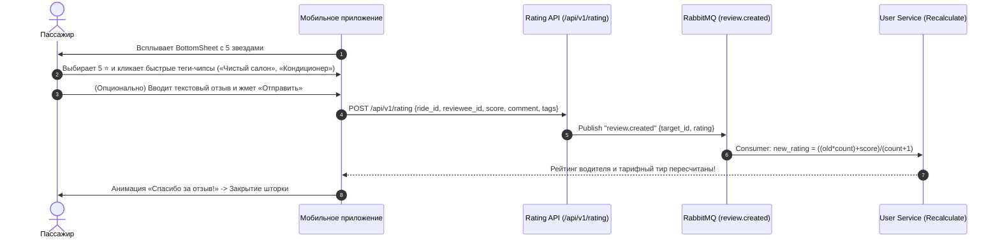

#### Элементы интерфейса экрана оценки:
1. **Аватар и имя собеседника:** Крупное фото и имя водителя / пассажира.
2. **Интерактивные звёзды (1–5 ⭐):**
   * Крупные иконки с тактильным виброоткликом (Haptic) при каждом нажатии.
   * Динамическая текстовая подпись под звездами:
     * 1 ⭐ — *«Очень плохо»*
     * 2 ⭐ — *«Плохо»*
     * 3 ⭐ — *«Нормально»*
     * 4 ⭐ — *«Хорошо»*
     * 5 ⭐ — *«Великолепно!»*
3. **Быстрые теги (Chips / Pills) в зависимости от оценки:**
   * **При выборе 4–5 ⭐ (Позитивные чипсы, зеленый контур):**
     * `✨ Чистый салон`
     * `❄️ Работал кондиционер`
     * `🤝 Вежливый водитель`
     * `🚗 Плавное и безопасное вождение`
     * `⏱️ Пунктуальность`
     * `🎵 Приятная музыка`
   * **При выборе 1–3 ⭐ (Конструктивная критика, оранжево-красный контур):**
     * `🧹 Грязный салон`
     * `🗣️ Грубость в общении`
     * `⚠️ Опасная езда`
     * `⏳ Сильное опоздание`
     * `🔊 Громкая музыка`
     * `🚬 Курение в салоне`
4. **Текстовое поле отзыва:**
   * Плейсхолдер: *«Расскажите подробнее о поездке (необязательно)»*.
   * Лимит: 500 символов со счетчиком.
5. **Кнопка «Отправить отзыв»:** Активна сразу после выбора звезд.

---

### 9.3. Принцип слепой взаимной оценки (Blind Reviews)

Чтобы избежать «мстительных» негативных отзывов (когда водитель ставит пассажиру 1 звезду только потому, что пассажир поставил ему 1 звезду):
1. Оценка и отзыв **НЕ отображаются** в профиле оппонента моментально.
2. Отзывы раскрываются **только после того, как обе стороны оставили свои оценки**, либо **автоматически через 24 часа** после завершения поездки.
3. До момента раскрытия статус отображается как: *«Ожидание оценки второй стороны»*.

---

### 9.4. Контракты API рейтингов

#### 1. Отправка отзыва (`POST /api/v1/rating`)
* **Метод:** `POST`
* **Адрес (URL):** `https://api.yolyolakay.com/api/v1/rating`
* **Заголовки:**
  ```http
  Content-Type: application/json
  Authorization: Bearer <access_token>
  ```
* **Тело запроса (JSON):**
  ```json
  {
    "ride_id": "18f2d5e1-8840-410e-a4b5-123456789abc",
    "reviewee_id": "a3d38bbb-eb6c-4c34-a85b-f5b241fa09e3",
    "score": 5,
    "tags": [
      "clean_interior",
      "polite_driver",
      "ac_working"
    ],
    "comment": "Отличная поездка, водитель пунктуальный, в машине прохладно и чисто!"
  }
  ```
* **Ответ (`201 Created`):**
  ```json
  {
    "id": "99999999-aaaa-bbbb-cccc-dddddddddddd",
    "ride_id": "18f2d5e1-8840-410e-a4b5-123456789abc",
    "reviewer_id": "00000000-0000-0000-0000-000000000001",
    "reviewee_id": "a3d38bbb-eb6c-4c34-a85b-f5b241fa09e3",
    "score": 5,
    "tags": ["clean_interior", "polite_driver", "ac_working"],
    "comment": "Отличная поездка...",
    "created_at": "2026-09-08T13:10:00Z"
  }
  ```

#### 2. Получение отзывов пользователя (`GET /api/v1/rating`)
* **Метод:** `GET`
* **Адрес:** `https://api.yolyolakay.com/api/v1/rating?reviewee_id={user_id}&limit=20&offset=0&with_comment=true`
* **Ответ (`200 OK`):**
  ```json
  {
    "average_rating": 4.85,
    "total_ratings": 47,
    "tier": "premium",
    "tag_summary": {
      "clean_interior": 38,
      "polite_driver": 42,
      "ac_working": 35,
      "safe_driving": 40
    },
    "feedbacks": [
      {
        "id": "99999999-aaaa-bbbb-cccc-dddddddddddd",
        "score": 5,
        "tags": ["clean_interior", "polite_driver"],
        "comment": "Все супер, рекомендую!",
        "created_at": "2026-09-08T13:10:00Z",
        "reviewer_name": "Азиз"
      }
    ]
  }
  ```

## 💳 СЦЕНАРИЙ 10: ПОДПИСКИ, ТАРИФНЫЕ ПЛАНЫ И БИЛЛИНГ (BILLING & SUBSCRIPTIONS)

### 10.1. Бизнес-модель: Подписка без комиссии (Zero-Commission SaaS)

> [!NOTE]
> В **Yol-Yolakay** водители не платят скрытые проценты с каждой поездки. Водитель оставляет себе 100% денег, полученных от пассажиров, оплачивая лишь фиксированный месячный тариф за право публикации поездок и доставку посылок.

#### Актуальная тарифная сетка водителя (Срок действия каждого тарифа — 1 месяц / 30 дней):

| Тариф (`plan_key`) | Название | Стоимость | Квота поездок (`rides_quota`) | Квота посылок (`free_parcels_quota`) | Срок действия | Связь с рейтингом (Сценарий 9) |
| :--- | :--- | :--- | :--- | :--- | :--- | :--- |
| **`driver_trial`** | **Free Trial** | **0 UZS** | **1 поездка** | **1 посылка** | **1 месяц** | Стартовый тест для новых водителей (однократно). |
| **`driver_plus`** | **Plus** | **5 000 UZS** | **2 поездки** | **2 посылки** | **1 месяц** | Для эконом-сегмента (рейтинг водителя $\le 3.0$). |
| **`driver_pro`** | **Pro** | **7 000 UZS** | **5 поездок** | **5 посылок** | **1 месяц** | Оптимальный пакет (рейтинг водителя $3.01 - 4.0$). |
| **`driver_premium`** | **Premium** | **10 000 UZS** | **До 60 поездок** | **Безлимитно** (`-1`) | **1 месяц** | Топ-водители с идеальным сервисом (рейтинг $4.01 - 5.0$). |

#### Актуальная тарифная сетка пассажира (Доступ к уровням водителей, 1 месяц / 30 дней):

| Тариф (`plan_key`) | Название | Стоимость | Доступ к категориям водителей | Особенности |
| :--- | :--- | :--- | :--- | :--- |
| **`passenger_free`** | **Free** | **0 UZS** | Базовые водители (рейтинг $\le 3.0$ и новички $<3$ отзывов) | Базовый доступ по умолчанию. |
| **`passenger_plus`** | **Plus** | **10 000 UZS** | Базовые водители (рейтинг $\le 3.0$ и новички $<3$ отзывов) | Эконом-пакет с поддержкой. |
| **`passenger_pro`** | **Pro** | **20 000 UZS** | Проверенные водители (рейтинг $3.01 - 4.0$) | Повышенный комфорт и безопасность. |
| **`passenger_premium`** | **Premium** | **35 000 UZS** | Топ-водители (рейтинг $4.01 - 5.0$) | Максимальный комфорт и высокий уровень сервиса. |

---

### 10.2. UX/UI Экрана тарифов и подписок (Subscription Hub)

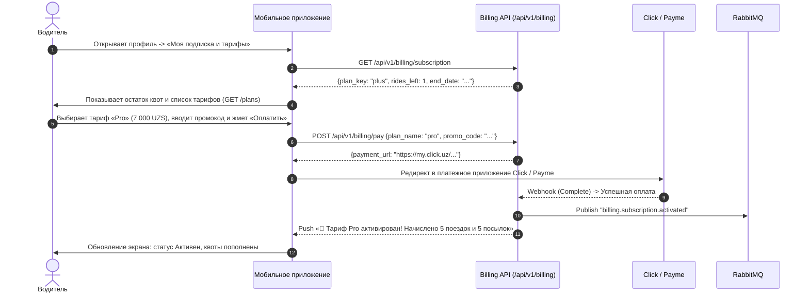

#### Элементы интерфейса:
1. **Виджет текущей активной подписки:**
   * Название активного плана и статусная плашка (`Активна до DD.MM.YYYY`).
   * Интерактивные счетчики оставшихся квот:
     * 🚗 Поездки: `Осталось 4 из 5` (круговой прогресс-бар).
     * 📦 Посылки: `Осталось 3 из 5` (или бейдж `Безлимитно` для Premium).
2. **Карусель тарифных планов:**
   * Карточки тарифов Plus, Pro, Premium с указанием цены в UZS.
   * Список включенных опций (с локализацией на узбекском и русском языках).
   * Подсветка рекомендуемого тарифа (`Pro` или `Premium`).
3. **Блок промокода:**
   * Текстовое поле с кнопкой **«Применить»**.
   * При успешном вводе моментально пересчитывается цена (с перечеркиванием старой стоимости и зеленой плашкой скидки).
4. **Способы оплаты:**
   * Список привязанных карт Uzcard / Humo (с маской `8600 **** **** 1234` и иконкой платежной системы).
   * Кнопка быстрой оплаты в 1 клик с сохраненной карты.
   * Кнопки перехода в приложения **Click** или **Payme**.

---

### 10.3. Контракты API биллинга

#### 1. Получение каталога тарифов (`GET /api/v1/billing/plans`)
* **Метод:** `GET`
* **Адрес (URL):** `https://api.yolyolakay.com/api/v1/billing/plans`
* **Заголовки:** `Authorization: Bearer <access_token>`
* **Ответ (`200 OK`):**
  ```json
  {
    "plans": [
      {
        "plan_key": "driver_trial",
        "plan_name": "Free Trial",
        "target_role": "driver",
        "price": 0,
        "currency": "UZS",
        "rides_quota": 1,
        "free_parcels_quota": 1,
        "features": ["1 trial ride", "1 trial parcel"],
        "features_uz": ["1 ta sinov safari", "1 ta sinov posilkasi"],
        "features_ru": ["1 пробная поездка", "1 пробная посылка"],
        "features_en": ["1 trial ride", "1 trial parcel"]
      },
      {
        "plan_key": "driver_plus",
        "plan_name": "Plus",
        "target_role": "driver",
        "price": 5000,
        "currency": "UZS",
        "rides_quota": 2,
        "free_parcels_quota": 2,
        "features_ru": ["До 2 поездок", "2 бесплатные посылки", "Действует 30 дней"]
      },
      {
        "plan_key": "driver_pro",
        "plan_name": "Pro",
        "target_role": "driver",
        "price": 7000,
        "currency": "UZS",
        "rides_quota": 5,
        "free_parcels_quota": 5,
        "features_ru": ["До 5 поездок", "5 бесплатных посылок", "Действует 30 дней"]
      },
      {
        "plan_key": "driver_premium",
        "plan_name": "Premium",
        "target_role": "driver",
        "price": 10000,
        "currency": "UZS",
        "rides_quota": 60,
        "free_parcels_quota": -1,
        "features_ru": ["До 60 поездок", "Безлимитные бесплатные посылки", "Действует 30 дней"]
      }
    ]
  }
  ```

#### 2. Проверка текущей подписки (`GET /api/v1/billing/subscription`)
* **Метод:** `GET`
* **Адрес:** `https://api.yolyolakay.com/api/v1/billing/subscription`
* **Ответ (`200 OK`):**
  ```json
  {
    "id": "c56d0e92-4f32-4b21-a189-9a70b217f22b",
    "user_id": "a3d38bbb-eb6c-4c34-a85b-f5b241fa09e3",
    "plan_key": "pro",
    "plan_name": "Pro Plan",
    "status": "active",
    "start_date": "2026-09-01T10:00:00Z",
    "end_date": "2026-10-01T10:00:00Z",
    "has_used_trial": true,
    "rides_left": 4,
    "free_parcels_quota": 5
  }
  ```
  *(Если подписки нет, бэкенд возвращает `200 OK` со значением `null`, предотвращая появление красных баннеров об ошибке в UI).*

#### 3. Инициация оплаты подписки (`POST /api/v1/billing/pay`)
* **Метод:** `POST`
* **Адрес:** `https://api.yolyolakay.com/api/v1/billing/pay`
* **Тело запроса (JSON):**
  ```json
  {
    "plan_name": "pro",
    "payment_token_id": "optional-uuid-saved-card",
    "promo_code": "YOLYOL20"
  }
  ```
* **Ответ (`200 OK`):**
  ```json
  {
    "message": "payment initiated",
    "payment_url": "https://my.click.uz/services/pay?service_id=12345&merchant_trans_id=...&amount=7000"
  }
  ```

#### 4. Работа с банковскими картами (Токенизация Uzcard / Humo)
* **Сохранить карту:** `POST /api/v1/billing/cards`
  ```json
  {
    "provider": "click",
    "token": "token_xyz_12345",
    "masked_pan": "8600 **** **** 4589"
  }
  ```
  *Ответ:* `201 Created` с сохраненным объектом карты.
* **Получить список карт:** `GET /api/v1/billing/cards`
  *Ответ:* `200 OK` со списком сохраненных платежных токенов.

---

### 10.4. Поведение приложения при исчерпании лимитов (Paywall UX)

1. **Публикация поездки с нулевым остатком поездок (`rides_left == 0`):**
   * При попытке нажать кнопку **«Опубликовать поездку»** экран блокируется.
   * Всплывает диалоговое окно (Paywall BottomSheet):
     > 🛑 **«Лимит поездок исчерпан»**  
     > *«В вашем тарифе закончились доступные поездки. Продлите подписку или выберите более выгодный тариф, чтобы продолжать брать попутчиков.»*  
     > **[ Выбрать тариф ]** *(ведет на экран подписок)*.
2. **Попытка включить расширенные фильтры без платной подписки:**
   * Если у водителя нет активного платного тарифа (`plus`, `pro`, `premium`), переключатели удобств (Кондиционер `has_ac`, Некурящий салон `no_smoking`, 2 человека сзади `max_two_back`) отображаются с замочком 🔒.
   * При тапе выводится подсказка: *«Опция доступна на тарифах Plus, Pro и Premium»*.
3. **Взятие посылки с нулевой квотой (`free_parcels_quota == 0`):**
   * Кнопка «Взять посылку» на детальном экране заказа посылки становится неактивной и предлагает докупить тариф с безлимитными посылками (**Premium**).

---

## 🚀 ЗАКЛЮЧЕНИЕ ПО ВСЕМ 10 СЦЕНАРИЯМ
Все 10 ключевых сценариев взаимодействия мобильных клиентов с бэкендом **Yol-Yolakay** полностью проработаны, согласованы и задокументированы в соответствии с реальной кодовой базой и бизнес-требованиями.

---

## 🛠 СВОДКА СИНХРОНИЗАЦИИ И ИСПРАВЛЕНИЙ (АУДИТ 9 СЕНТЯБРЯ 2026)

В ответ на детальный аудит клиентской команды (Web + Android) от 9 сентября 2026 года в бэкенд внесены следующие критические исправления и доработки контрактов:

### 1. Исправления критических ошибок (Level 1)
* **gRPC-канал отзывов (`rating_service` -> `ride_service:50053`)**:
  * В `ride_service` поднят полноценный gRPC-сервер на порту `:50053` (`RideServiceServer`).
  * `rating_service` успешно обращается к `RIDE_GRPC_URL=ride_service:50053` для валидации завершенных поездок перед созданием отзыва (ошибка `Unavailable / connection refused` полностью устранена).
* **Сохранение и отдача пожеланий к посадке (`pickup_preference`)**:
  * В таблице `bookings` размер поля увеличен до `VARCHAR(255)`.
  * В `internal/ride/delivery/http/dto.go` на эндпоинте бронирования добавлена валидация `binding:"max=250"` — при превышении возвращается `400 Bad Request` с понятным сообщением вместо падения базы `22001`.
  * В репозитории `ride` исправлен маппинг: `PickupPreference` теперь корректно отдается в `GetBookingByID`, `GetBookingsByRideID` и `GetBookingsByPassengerID`.
* **Логика квоты поездок (`rides_left`) и закрытие лазейки бесконечных поездок**:
  * При создании поездки в статусе `draft` квота НЕ списывается. Квота списывается на -1 только при публикации/активации поездки (`POST /rides/{id}/activate`).
  * При отмене поездки (`POST /rides/{id}/cancel`) событие `ride.cancelled` передает флаг `was_activated: bool`. Биллинг производит `RefundRideLimit` (+1 к поездкам) ТОЛЬКО если поездка была реально активирована (`status == active || in_progress`). Отмена черновиков (`draft`) больше не начисляет поездки.

### 2. Бизнес-модель: Бесплатный доступ для пассажиров (Zero-Commission Driver-SaaS)
* **Пассажиры ничего не платят платформе**:
  * Платформа монетизируется исключительно за счет подписок водителей (SaaS).
  * Поиск поездок (`GET /api/v1/rides/search`) на 100% бесплатен и доступен всем пассажирам без искусственных ограничений и тарифов. Все пассажиры видят всех доступных водителей.
* **Каталог планов (`GET /api/v1/billing/plans`)**:
  * Эндпоинт открыт публично.
  * Возвращает водительские тарифные планы (`driver_trial`, `driver_monthly`, `driver_quarterly`, `driver_yearly`), а для пассажиров возвращает `passenger_plans: []` (пассажирские подписки отсутствуют).
* **Корректность узбекской латиницы в комментариях**:
  * Убран `html.EscapeString`, превращавший апострофы в `&#39;`. Слова `o'zbekcha`, `bo'ldi`, `yo'l-yo'lakay` сохраняются и возвращаются в чистом текстовом виде.

### 3. Заезд в город, трасса, бронирование и попутчики (Level 2)
* **Заезд в город (`allows_city_detour`, `city_detour_fee`)**:
  * Водитель при создании поездки может указать: `allows_city_detour: true`, `city_detour_fee: 15000`.
  * Поля сохраняются в БД `rides` и возвращаются во всех ответах (`SearchRides`, `GetRideByID`, `GetRidesByDriverID`, `GetActiveRidesToDestinations`).
* **Тип высадки и расчет стоимости (`dropoff_type`)**:
  * При бронировании пассажир может передать `dropoff_type`: `"highway"` (по умолчанию), `"city_detour"` (или синоним `"door"`).
  * Значение сохраняется в БД `bookings.dropoff_type` и возвращается в ответе.
  * Если пассажир выбирает `city_detour` и водитель разрешил заезд (`allows_city_detour == true`), итоговая стоимость `total_price` автоматически рассчитывается как `(price_per_seat * seats) + city_detour_fee`.
* **Посылки (`POST /api/v1/parcels/`)**:
  * Сохраняются и возвращаются в БД `romanova`: `receiver_name: string` (имя получателя) и `dropoff_type: string` ("highway" / "door").
* **Список подтвержденных пассажиров рейса и проверка женщин**:
  * `GET /api/v1/rides/{id}` всегда включает массив `passengers` (не опускается через `omitempty`, пустой список возвращает `[]`).
  * Для подтвержденных бронирований подтягиваются профили пассажиров, включая `gender` (`"male"` / `"female"`), `name`, `avatar`, `rating`, `phone_number`, `kyc_status`, что обеспечивает проверку рейсов «только для женщин».
  * Выделенный эндпоинт `GET /api/v1/rides/{id}/passengers` также возвращает список пассажиров с полем `gender`.

### 4. Роутинг и авторизация шлюза (Level 3)
* **Завершающие слэши (307 Temporary Redirect)**:
  * В `ride_service` зарегистрированы оба пути: `POST /api/v1/rides` и `POST /api/v1/rides/`.
  * В `parcel_service` зарегистрированы оба пути: `POST /api/v1/parcels` и `POST /api/v1/parcels/`.
* **Тестовый эндпоинт авторизации**:
  * В `api_gateway` эндпоинт `POST /api/v1/auth/mock-otp` добавлен в белый список `publicRoutes` — мобильные тестеры могут беспрепятственно тестировать авторизацию.

---

### 5. Официальные ответы и контракты по итогам аудита (9 сентября, вечер)

#### 5.1. Канонический стандарт `dropoff_type` (Вопрос E)
* **`"highway"`** — посадка/высадка вдоль основной трассы / на повороте (по умолчанию, без дополнительных доплат).
* **`"city_detour"`** — заезд вглубь города / доставка до двери адресата (добавляет `city_detour_fee` к стоимости).
* *Примечание по обратной совместимости:* Бэкенд в поездках и посылках принимает `"city_detour"`, а также сохраняет поддержку устаревшего синонима `"door"`, нормализуя его к `"city_detour"`. Клиентским приложениям (Web и Android/iOS) рекомендуется использовать каноническое значение **`"city_detour"`**.

#### 5.2. Оплата подписок водителей и бесплатность пассажиров (Пункты B и J)
* **Пассажиры**: Пользуются сервисом **100% бесплатно**.
  * `GET /api/v1/billing/subscription` для пользователей с ролью `passenger` возвращает `null` (водительской подписки нет).
  * При регистрации пассажиру **не** начисляется `driver_trial`. Пробный период активируется только при верификации водителя (`user.verified`).
  * `POST /api/v1/billing/pay` с `passenger_*` возвращает понятную ошибку `400 Bad Request` («passenger service is 100% free, paid subscriptions are for drivers only»).
* **Водители (`POST /api/v1/billing/pay`)**:
  * Эндпоинт принимает как `plan_key`, так и `plan_name`:
    ```json
    {
      "plan_key": "driver_pro"
    }
    ```
  * Поддерживаемые ключи планов:
    * `"driver_plus"` (5 000 UZS, 2 поездки, 2 посылки)
    * `"driver_pro"` (7 000 UZS, 5 поездок, 5 посылок)
    * `"driver_premium"` (10 000 UZS, 60 поездок, безлимитные посылки)

#### 5.3. Теги отзывов и чипы 9.2 (Пункт K)
* **Отправка отзыва (`POST /api/v1/rating`)**:
  * Принимает массив тегов `tags: string[]`:
    ```json
    {
      "ride_id": "...",
      "reviewee_id": "...",
      "score": 5,
      "comment": "O'z vaqtida yetib keldik, mashina toza!",
      "tags": ["clean_car", "punctual", "polite"]
    }
    ```
  * Возвращает созданный отзыв с массивом `tags`.
* **Получение отзывов (`GET /api/v1/rating?reviewee_id=...`)**:
  * Каждый элемент списка `items` содержит массив `tags: string[]`.
  * В корне ответа возвращается объект агрегации тегов `tag_summary` для построения чипов (раздел 9.2):
    ```json
    {
      "items": [
        {
          "id": "...",
          "ride_id": "...",
          "reviewer": { "id": "...", "name": "..." },
          "score": 5,
          "comment": "O'z vaqtida yetib keldik, mashina toza!",
          "tags": ["clean_car", "punctual"],
          "created_at": "2026-09-09T18:00:00Z"
        }
      ],
      "total": 1,
      "average": 5.0,
      "tag_summary": {
        "clean_car": 1,
        "punctual": 1
      }
    }
    ```

---

### 6. Xarita va Marshrutlar Bo'yicha Yangilanishlar (16-sentabr 2026)

Frontend jamoasining xarita kengaytirilishi (5 tadan 13 ta joyga) bo'yicha yuborgan murojaati asosida barcha 5 ta band to'liq amalga oshirildi, serverlarga joylandi va jonli prodda tekshirildi.

#### 6.1. 🔴 P1 · Watch Token (Oila a'zolari uchun safarni jonli kuzatish)
* **Maqsad:** Havola orqali ochiladigan veb-sahifa yoki ilovada haydovchining GPS nuqtasini ro'yxatdan o'tmasdan kuzatish (shaxsiy ma'lumotlar oshkor bo'lmaydi).
* **Token olish (Haydovchi yoki Tasdiqlangan yo'lovchi):**
  * `POST https://api.yolyolakay.com/api/v1/rides/{id}/watch-token`
  * Header: `Authorization: Bearer <token>`
  * Javob (`200 OK`):
    ```json
    {
      "token": "wt_7d7376a81285cf62ba87f820b91108e4",
      "expires_at": "2026-09-17T09:55:30.207465285Z"
    }
    ```
* **Jonli lokatsiyani olish (Ochiq havola, Auth shart emas):**
  * `GET https://api.yolyolakay.com/api/v1/rides/{id}/location?watch_token=wt_...`
  * Yoki Header: `X-Watch-Token: wt_...`
  * Javob (`200 OK`):
    ```json
    {
      "lat": 41.3111,
      "lon": 69.2797,
      "heading": 85.5,
      "updated_at": "2026-09-16T09:57:00Z"
    }
    ```
* **Tokini bekor qilish:**
  * `DELETE https://api.yolyolakay.com/api/v1/rides/{id}/watch-token?token=wt_...` (yoki JSON `{ "token": "wt_..." }`)

#### 6.2. 🔴 P2 · Uchrashuv nuqtasi koordinatalari (`pickup_lat`, `pickup_lon`)
* **Maqsad:** Haydovchi e'lon berayotganda uchrashuv joyini matn bilan birga xaritadan tanlaydi (`pickup_lat`, `pickup_lon`).
* **Safar yaratish / tahrirlash:**
  * `POST /api/v1/rides/` va `PUT /api/v1/rides/{id}`
  * So'rov tanasi:
    ```json
    {
      "pickup_point": "Chorsu bozor yonida",
      "pickup_lat": 41.3275,
      "pickup_lon": 69.2389
    }
    ```
    *(Eslatma: `pickup_point_lat` va `pickup_point_lon` aliaslari ham qabul qilinadi).*
* **Safar ma'lumotlari va Qidiruv:**
  * `GET /api/v1/rides/{id}` va `GET /api/v1/rides/search` javobida `pickup_lat` va `pickup_lon` qaytariladi.

#### 6.3. 🔴 P3 · Bildirishnomalar tarixida Kontekst IDlar
* **Maqsad:** Push kelganda yoki bildirishnomalar ro'yxatida to'g'ridan-to'g'ri kerakli safar/bron/posilka ekraniga o'tish (deep linking).
* **Bildirishnomalar ro'yxati:**
  * `GET https://api.yolyolakay.com/api/v1/notifications`
  * Har bir ob'ektda mavjud bo'lganda IDlar qaytariladi:
    ```json
    {
      "id": "060d991a-fbac-4e29-89e7-c8754bb45bf0",
      "title": "Safar yangilanishi",
      "body": "Haydovchi safarni boshladi",
      "type": "ride_started",
      "is_read": false,
      "ride_id": "16e2cc97-f27c-48f1-9d7c-ca8293c788f4",
      "booking_id": "22222222-2222-2222-2222-222222222222",
      "parcel_id": null,
      "data": {
        "click_action": "OPEN_RIDE",
        "screen": "ride_detail"
      },
      "created_at": "2026-09-16T10:00:00Z"
    }
    ```

#### 6.4. 🟡 P4 · Posilka qidirishda marshrut koridori (Corridor Search)
* **Maqsad:** Haydovchi A shahardan B shaharga ketayotganda yo'l yoqasidagi barcha posilkalarni ko'radi.
* **Qidiruv so'rovi:**
  * `GET https://api.yolyolakay.com/api/v1/parcels/search?lat=41.2995&lon=69.2401&dest_lat=39.6542&dest_lon=66.9597&corridor_km=25`
  * Parametrlar:
    * `lat` (yoki `origin_lat`) — haydovchining boshlang'ich kengligi
    * `lon` (yoki `origin_lon`) — haydovchining boshlang'ich uzunligi
    * `dest_lat` (yoki `destination_lat`) — haydovchining manzil kengligi
    * `dest_lon` (yoki `destination_lon`) — haydovchining manzil uzunligi
    * `corridor_km` — koridor radiusi (default: 25 km)
  * Agar `dest_lat`/`dest_lon` berilmasa, eski bitta nuqta atrofidagi radius bo'yicha qidiruv avtomatik ishlaydi.

#### 6.5. 🟡 P5 · Haydovchi profilida ochiq marshrutlar
* **Maqsad:** 3-shaxs haydovchi profiliga kirganda (yoki e'londan o'tganda) uning ochiq safarlarini ro'yxatdan o'tmasdan ko'rishi.
* **Ikkala URL ham ishlaydi (Auth shart emas, ochiq):**
  * `GET https://api.yolyolakay.com/api/v1/rides/driver/{driver_id}`
  * `GET https://api.yolyolakay.com/api/v1/users/{driver_id}/rides`
* **Javob (`200 OK`):**
  ```json
  {
    "rides": [
      {
        "id": "ae841919-b42a-44e0-ad09-8059eca9e0e6",
        "driver_id": "00000000-0000-0000-0000-000000000001",
        "origin_address": "Tashkent",
        "destination_address": "Samarkand",
        "origin_lat": 41.2995,
        "origin_lon": 69.2401,
        "dest_lat": 39.6542,
        "dest_lon": 66.9597,
        "departure_time": "2026-09-18T07:35:24Z",
        "price_per_seat": 100000,
        "status": "active"
      }
    ]
  }
  ```
  *(Yo'lovchilar ma'lumotlari kiritilmaydi, faqat marshrut, vaqt, narx va holat qaytadi).*


